# Sprint 7b: Arena 1, pass 2 (guided pauses, constellations, weather, the ring, the ending)

Branch `sprint-7b-arena`, based on `sprint-7-merge` (`16858fb`). Nothing pushed to `main`, nothing deployed, no new dependency, no migration. The
online transport (`src/game/relay.ts`, the WebRTC / relay code in `src/game/useGameRoom.ts`, `src/app/api/rooms/**`) is untouched. Normal fights are
unchanged: `check-sim` still hashes three scripted normal fights against the value taken on `main`, and `npx tsx scripts/balance.ts 200` prints
exactly what `main` prints (the diff is in section 3, part by part).

Work order, one commit per part, the gate after each (sections 1-3 grow part by part): **A** guided pauses, **B** opening ceremony and constellations,
**C** weather, **D** lava leak, **E** the ring and the buff roll, **F** the ending, **G** the UI to `docs/design/arena-1/ui-reference.png`.

## 1. What changed

### A. Guided pauses (the "cue" phase)

A new sim phase, `"cue"`, with `Match.cue = { id, text, until, hold, target?, done, fin? }`. While it runs the **match clock and the fight hold still**
(`m.timer` doesn't move, nothing is dealt, no meter fills, no cooldown matters), **nobody can attack, guard, cast or use a side skill**, and the
fighters may **walk and jump only when the cue has marks to go to** (`target`, one `{x, y, r}` per fighter: stand within `r` px of `x` on the surface at
height `y`). A fighter who has reached the mark is `done` and is held there (no input moves them) until the other arrives. The cue ends when both are `done`
and have lingered `hold` ticks (so the arrival reads), or `until` ticks after it began. Every instruction that says "go here" is a cue.
It lives in `Match` and therefore in every `Snapshot` (`cloneCue`, a few dozen bytes), so it is host-authoritative and works online as is (the guest just
draws it); `resumeMatch` restores it.

- `src/game/sim.ts`: `Phase` gets `"cue"`; `startCue`, `cueTick`, `calm` (a pause starts from a quiet fight: projectiles, timed hazards, moves in progress, a
  held victim and queued presses are cleared; health, meter and cooldowns stay). Presses are still *read* in a pause so none is left over when the fight
  resumes (a punch hammered during the pause doesn't fire on the first fight tick); only the jump counts. Every other phase reads input exactly as before
  (the normal-mode golden hash proves it).
- `src/game/arena.ts`: **the story**: `STORY`, a list of beats, each `{ id, at?, make, end? }`. A beat with `at` waits for that match tick, one without it
  follows the previous beat at once; `a.beat` counts the beats told. `arenaBeat` (checked after every counted fight tick), `arenaCueTick`, `arenaCueEnd`.
  This part's only beat is **`climb`**: at the 9000th fight tick (the start of scene 5) the fight stops with "GET UP THERE!", the staircase rises, and the
  pause ends when both fighters stand on the final platform (the mark is the whole top of the platform). After 25 s whoever is still below is lifted
  onto it (`warp` event); the computer never needs that (asserted).
- **The world clock** (`arenaWorld(m)` = match clock + ticks spent in pauses, `ArenaState.pause`): what moves by itself (the staircase, the lava) runs on it,
  so the stairs rise *during* the pause while the match clock holds. Platforms, `lavaY`, `standingOn`, `arenaSurface`, the rescue, the renderer and the
  CPU use it; scenes, hazards and the heat use the match clock. `lavaY` stops 35 px under the final platform however long the pauses were.
- The staircase is the same shape (asserted by `scripts/arena.ts`: rises, gaps, widths) but **faster**: step 1 warns at 8700 and rises at 9000, steps 2 warn
  at 9000 and rise at 9150, the final platform warns at 9150 and rises at 9300 (90 ticks); everything stands 6.5 s after scene 5 begins (it was 21 s).
  Every rock still warns at least 2 s ahead (dust, rumble, hopping pebbles).
- `src/game/arenaNav.ts` (computer): `cueNav` walks to the mark, climbing to it when it is up on a platform and waiting when the stairs aren't built far enough.
  `planHops` / `pickHop`: of the comfortable takeoffs it takes the one nearest to where it stands (before, everyone queued for the single best spot, and two
  fighters who both wanted the same spot pushed each other away from it for ever; found by the climb test). `nextHop` tries nodes nearest first, so of two
  equally short staircases a fighter takes the one on its own side.
- `src/game/arenaRender.ts`, `render.ts`: the headline plate ("GET UP THERE!", `P1 ✓ / P2 …` under it), the marks (stand-here pads for small marks; for the
  final platform a gold dashed line with arrows along its top), the camera keeps the mark in frame, a `cue` and a `warp` sound / puff.
- `scripts/check-sim.ts`, `scripts/arena.ts`: see the tests below. `scripts/shots-7b/` draws the screenshots (below).

**Tests:** `check-sim` asserts the pause starts at exactly 9000 played ticks and not before; the match clock holds while the world clock runs and the stairs rise;
no attack, guard, cast, skill or meter movement in a pause and nothing queued survives it; walking and jumping work; a fighter in place is held; the pause
ends after the linger and the clock resumes where it stopped; the timeout lifts stragglers; a snapshot in a pause survives JSON and a resumed match carries on
identically; what was in flight is cleared at the start. `scripts/arena.ts` plays the pause with two computer fighters from 10 start positions for the weakest
jumper (AGI 40 / SPD 40), a strong one (AGI 100) and a mixed one: all finish in 7.5-10.7 s, none needs the timeout lift.


Phone (390 px canvas, device scale 3):


### B. Opening ceremony and constellations (the first 15 s, no fighting)

An arena fight now opens with three guided pauses (the story's first beats, `open` → `pick` → `settle`; the intro title card before them is 1.5 s):

1. **`open`, "THE STARS WAKE" (2 s):** all five constellations light up in the sky; the camera looks up (zoom 0.85) with the sky above and the fighters below; no health bars
   or clock yet, a title card ("ARENA 1 / INFERNO CRATER") instead.
2. **`pick`, "CHOOSE YOUR CONSTELLATION" (9 s at the most):** each fighter gets a black-and-grey pop-up (P1 left, P2 right) listing the five, the cursor in their colour, the
   focused one's skill on a yellow plate. **Left / right move the cursor one place per press** (a held key doesn't repeat), **punch locks it**: keys, the on-screen D-pad and
   PUNCH button, or a gamepad. A constellation someone has locked can't be locked again and the cursor skips it. If both lock on the same tick P1 gets it and P2's press is
   consumed (it must not lock the next one by surprise). When both are locked the pause lingers 0.75 s so the stamp reads; a fighter who hasn't locked when the 9 s run out gets the one
   under the cursor. **The computer picks at random** (`Math.random` in its brain, like the rest of its play): it thinks 0.75-3.5 s, scrolls one place every 8 ticks and punches.
3. **`settle`, "THE STARS ARE SET" (2 s):** the three unchosen ones fade, the two chosen ones glide over their fighter's side of the sky and settle to a dull glow, and stay there for
   the whole fight. **The longest the ceremony can take is 15.25 s** (1.5 + 2 + 9 + 0.75 + 2); the computer takes 8.6 s on average (`scripts/arena.ts`).

The pick is `ArenaState.pick` (the locked constellation per fighter), `cur` (the cursor) and `dir` (the direction held last tick, so a press moves once): they ride in every snapshot,
so a guest sees the cursors move and the picks, and `resumeMatch` restores them. A lock is a `star` event (sound, ring and sparks in the sky). `ConstellationId` is in `src/game/protocol.ts`.

**What each constellation grants for the whole fight** (`ARENA_TUNE.stars`, the numbers from the sheet; the pop-up text is written from them):

| Constellation | Skill | Where it acts |
|---|---|---|
| Phoenix | lava and cracks deal 40% of their damage (60% less) | `arenaStep`, on the crack / lava damage |
| Hare | jump ×1.15, air control ×1.3, all match | `arenaBoost(m, slot)`: stacks with scene 5's boost; the computer plans its jumps with it |
| Tortoise | the environment-damage cap is halved (8% → 4% of the pool per 10 s), scorch weakness capped at 10% | `envHurt`, the weakness cap |
| Serpent | hits on a scorched opponent (weakened by lava or a crack) deal +10% | `arenaDamageFactor`, called from `applyHit` |
| Comet | the special meter fills 15% faster | `energyGain` (`arenaEnergyMul`) |

Environment damage still never knocks anyone out and the caps are per fighter; "scorched" is the HUD's `SCORCHED -n% DMG` state. Nothing here touches a normal fight: every hook is
behind `m.arena`.

- `src/game/arena.ts`: `CONSTELLATIONS`, `starInfo`, the three beats, `arenaCueInput` (read before the fighters consume the buttons), `arenaOpen`, the skill hooks above.
- `src/game/sim.ts`: the intro leads into the ceremony for an arena fight (`ARENA_TUNE.ceremony.intro`), `arenaCueInput` is called before the fighters update, the hooks.
- `src/game/arenaStars.ts` (new): the five constellations drawn procedurally (stars joined by lines, each its own colour), baked once to a small canvas and stamped with an alpha.
- `src/game/arenaRender.ts`, `render.ts`: the sky (all five in a row, rings and tags for who looks at / locked which, the glide at the settle, the dull pair afterwards), the sky
  dimmed while the stars are the point, the ceremony camera, the pop-ups (a compact one for a phone: only the player's own, larger), the title card, `★ Serpent` beside each name,
  `chime` (a lock), `shimmer` (the stars waking) and a tick when the local player's cursor moves (`src/game/sound.ts`).
- `src/game/arenaNav.ts`: `pickNav`.

**Tests:** `check-sim` asserts the intro leads into `open` → `pick` → `settle` → the fight and that the match clock doesn't move before it; presses do nothing in `open`; one press = one place, a held
key doesn't repeat, left goes back, the list wraps; a same-tick tie goes to P1 and P2's press is consumed; the cursor skips what the other fighter took; a timeout locks the cursor's constellation
for whoever hasn't locked and nobody ever shares one; both locking ends the pick after the linger, not the timeout; nobody loses health or meter in the ceremony; the pick survives JSON and
`resumeMatch`; the longest ceremony is at most 16 s; and **every skill**: Phoenix takes 0.4 of a crack's damage, Tortoise stays under half the cap in lava and under 10% scorch (others don't), the Hare's
jump apex rises by the squared factor and stacks with scene 5's boost, the Serpent's +10% needs a scorched foe, the Comet's meter fills 1.15x as fast. `scripts/arena.ts` prints the computer's picks
(spread 18-22% each over 440 picks, never the same constellation twice) and the ceremony length.


Phone (390 px canvas, device scale 3; only the player's own pop-up, larger):


### C. Weather change in slow motion, and a heatwave you can see

- **The sky, light and ash build up over 9 s** (`ARENA_TUNE.weather.fade`, 540 ticks; it was a 2 s cut-fade). The five baked backdrops are crossfaded with a smooth curve, and the things that used
  to switch on at a scene's first tick follow the same curve: the embers and the ash (a continuous "mood" number 0..4 drives their rate and the share that is ash), the molten edge of the floating
  rocks, the heat. The fade is measured on the **world clock**, so scene 5's sky keeps coming in while the guided pauses hold the match clock. The next scene is baked only after the current one has
  fully come in, so the one fading out is never evicted mid-fade (three backdrops at most are kept, as before).
- **The heatwave** (`heatAt(world)`: 0 in scene 1, builds over the fade into scene 2, full through scene 2, then settles to 45% for the rest of the fight):
  - a **stronger shimmer**: 12 wavy lines of bent light (up to ~9 px swing) and eight soft plumes of hot air drifting over the floor, instead of six faint lines;
  - an **orange haze** over the far air, thickest at the floor, and a pool of warm light round the volcano's foot;
  - **warped background lines**: the band from the volcano's foot to the floor (y 300-470) is drawn in 5 px slices, each pushed sideways by a travelling wave (up to 3.4 px), so the spires, the lava river
    and the cliffs wobble like air over hot stone;
  - **sweat and steam on the fighters**: drops run off the head, pale puffs rise off the shoulders (`render.ts`, through the existing particle list, which now takes a per-particle gravity so steam rises).
  "Reduce flashes" scales all of it down (shimmer x0.3, warp x0.15, haze half, sweat and steam x0.35).
- `src/game/arenaRender.ts` (`backdrop`, `haze`, `mood`, `heatAt`), `src/game/render.ts`, `src/game/arena.ts` (`ARENA_TUNE.weather`). Nothing in the sim changed.

**Tests:** `check-sim` asserts the fade is 8-10 s and the heat curve (zero before scene 2, builds without a dip over the fade, 1.0 through scene 2, settles at 0.45 and stays). The look is from the screenshots.

Desktop (the fade from scene 1 to 2 is the second picture; the heatwave itself the third):


Phone:


### D. Scene 3: the cracks leak lava

A leaking crack was a flat glowing patch with a drip. Now (render only, `src/game/arenaRender.ts`: `leak`, `legGlow`):

- **A pool of lava on the floor strip** with a gentle mound, an ink rim, a lit crown, bubbles popping on it, and a much wider glow (1.5x the zone's width instead of 0.9x; it lights the floor and the air round it).
- **A lava fall over the lip of the slab:** a wavering sheet that leaves the pool and spreads as it drops down the 52 px front face, streaks running down it, bright flecks carried along, into the lake below where it
  **flares, ripples and throws up droplets**. The three static fissures of the telegraph are replaced by it once the crack is live.
- **A spray** of 14 droplets leaps off the pool in the first half second of a leak.
- **Glow on the fighters' legs:** an additive orange glow round the feet of anyone standing in or within 80 px of a leaking crack, strongest inside the zone (where it hurts).
- Everything is a function of the clock (no particle list, nothing to leak between frames). "Reduce flashes" leaves out the spray and the droplets.

**Same fairness limits as before, untouched, because the sim isn't:** at most 2 zones at once, a glow of 1.67 s that is harmless and hatched, never within 90 px + body of a fighter, a safe strip of 200 px, the 8%-per-10-s cap
that never takes the last point of health, scorch weakness (all of it asserted by the unchanged `check-sim` tests). **The pool is as wide as the zone that hurts** (plus its 3 px rim): only the glow and the fall are bigger, so
the picture never overstates what is dangerous. The telegraph still looks different from the leak (hatched flat patch, then the pool and the fall).

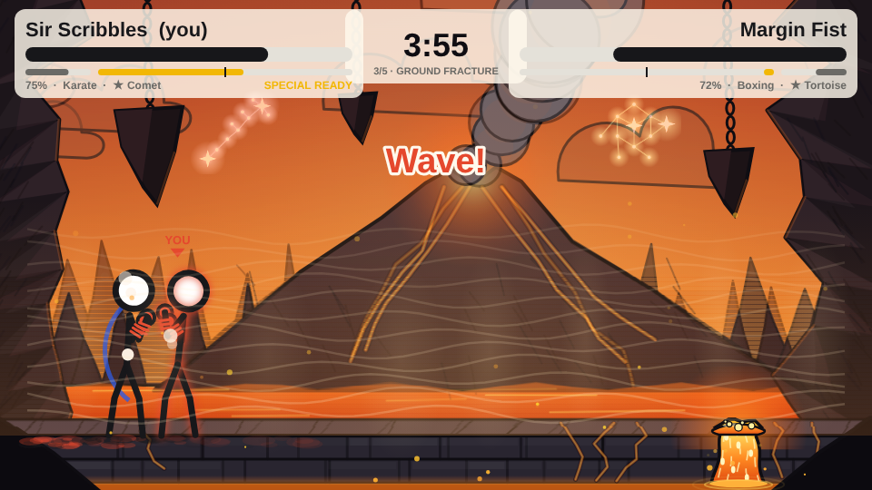
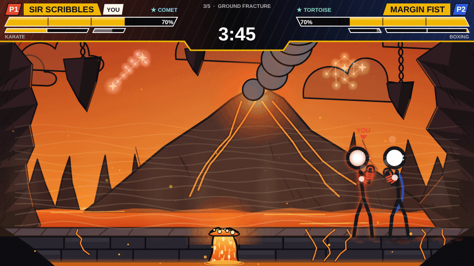
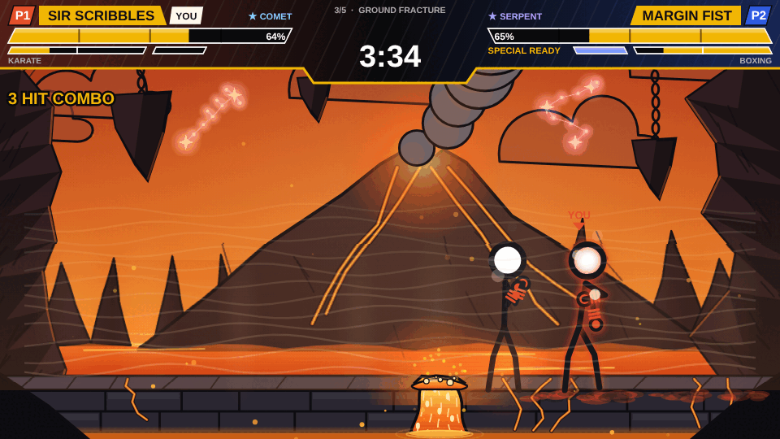

Phone:

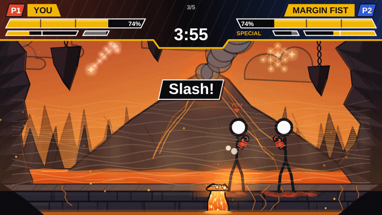
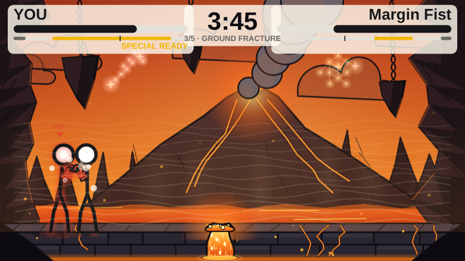
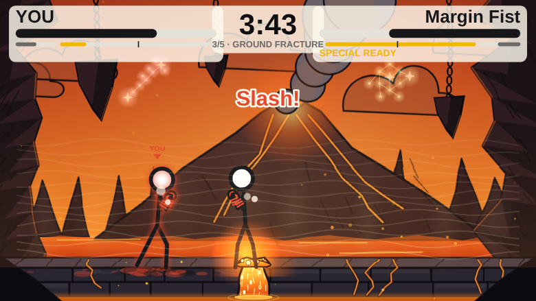

### E. Scene 4 to 5: the climb, the ring, the stars answer

Scene 5's story is now three guided pauses in a row, then the fight:

1. **`climb`, "GET UP THERE!"** (part A): the staircase rises, the fight is paused, nobody fights on the stairs.
2. **`marks`, "TAKE YOUR MARKS"**: the ring rises and each fighter walks to a stand-here mark. **The fighter standing further left takes the left mark**, 95 px either side of the centre, so they face each other from
   opposite sides (a tie goes to P1 on the left). A small mark is 28 px wide (`ARENA_TUNE.marks.r` 14); the pad is drawn a little wider so it is easy to see. The pause lingers 80 ticks once both are in place, which is how long
   the ring needs to rise; whoever isn't there after 10 s is put on their mark.
3. **`reveal`, "THE STARS ANSWER"** (4.5 s): each fighter's constellation flares bright in the sky and the **plausibility roll** is shown, one fighter at a time (P1 at 1 s, P2 at 2.5 s): a beam of light comes down
   from the constellation, rings spread, the roll floats up over the fighter ("COMET BLESSES P1, +42%"), the fighter grows and a glow in the constellation's colour circles them. The HUD hides for these 4.5 s (the sky is the point) and
   comes back with a gold **+N%** chip beside each name.

**The roll** is 10-50% (an integer, `ARENA_TUNE.buff`), **one per fighter, seeded: `roll(m, 700 + slot)`** (the sim's own `roll`, with the match's seed mixed in). It becomes a buff the way the admin buff works, in its two halves:
what the fighter **deals is multiplied by (1 + p)** and what they **take is divided by (1 + p)** (the admin buff's 1.3 / 0.75 for p = 30%). The two halves are applied in `arenaDamageFactor` (called from `applyHit`, so every
blow, special and ultimate carries them) instead of by rewriting `FighterDef`, so a resumed match has them too. Environment damage is not touched. `ArenaState.buff` holds the two percentages.

**The seed (new):** `roll(m, salt)` is a function of the round, the match clock and the salt, and the clock is the same at the same moment of every match, so every arena match would have rolled the same buffs (and put every
crack in the same place). `createMatch(..., { arena, seed })` takes a seed, which goes into `ArenaState` (and every snapshot) and is mixed into every arena roll. The sim still never calls `Math.random`; the two places that start a
match (`useCpuMatch`, and the host in `useGameRoom`, one argument on the line that already passed the mode) pick it with `Math.random()`, as the CPU already does. Without a seed (tests, tools) every roll repeats.

**A bigger final platform** (it was 420 px wide, now **480**) so two fighters have room between the walls, and the steps moved out to make space (step 1 at x 65-145, step 2 at 160-230, mirrored; the gaps and the rises are as
before, so the weakest jumper still climbs it: `scripts/arena.ts` checks with the real sim). Inside the walls a fighter's centre has 374 px.

**The ring:** a stone post at each end of the platform with three ropes between them (red, white, blue) that rise over 1 s; **the walls are solid from 2 s after they start to rise** (`ARENA_TUNE.ring`: inset 18 px, lock 120 ticks).
Anyone at or above the platform is held inside them: a held walk, a shove, a launch, an ultimate's hit-lock pin and the 'drop through' (hold block + jump) all stop at the walls, so **nobody falls off mid-fight**
(`arenaRingClamp`, `arenaCanDrop`, asserted over 40 s of a random masher and in 440 computer fights). The tip about dropping down from a platform is gone with the free-for-all stairs.

**Scale and camera:** in the ring the camera frames the whole platform (zoom 0.8) and **the fighters are drawn 12% smaller** (a drawing change: `ctx.scale` about the feet in `render.ts`; **the hitboxes in the sim are unchanged**, and the
shadows now fall on the platform they stand on). A buffed fighter is drawn **1.10x-1.20x bigger** by the roll (10% -> 1.10, 50% -> 1.20, `buffScale`).

**Class balance with the ring:** a solid ring changes the fight (a long duel, no way to be shoved into the lava), and the fighters who live on space suffered (Tank-Attacker 79%, Sword-Fighter 32% in the first run). Two fixes:
the computer's "cornered" test (an Attacker jumps over a Tank that has pinned it, a Sword stops stepping back into a wall) now uses the ring's walls instead of the arena's, which are 230 px further out (`fightBounds`; the
numbers for a normal fight are the same, asserted by the unchanged `balance.ts 200`); and `ARENA_TUNE.matchup` was re-fitted with `npx tsx scripts/arena.ts --tune 100` (Sword-Attacker 1.069 -> 1.1, Sword-Tank 0.96 -> 1,
Sword-Fighter 0.991 -> 1.033, Tank-Fighter 0.928 -> 0.939, the rest within 1.5%). The random buff pulls every pair towards 50% (the fighter with the bigger roll won 63% of the decided fights).

`src/game/arena.ts` (the beats, `ringBounds` / `arenaRingClamp` / `arenaCanDrop`, `buffScale`, the seed, `ARENA_TUNE.ring / marks / buff`), `src/game/sim.ts` (the seed, the clamp, the drop rule), `src/game/cpu.ts`,
`src/game/arenaNav.ts` (`fightBounds`), `src/game/arenaRender.ts` (`ring`, `reveal`, `fighterScales`, `buffShown`, the camera, the stars over the side a fighter stands on), `src/game/render.ts` (the scale, the glow, the circling
stars, the chips, the dust and the sound when the walls rise), `src/game/sound.ts` (`aura`), `src/game/useCpuMatch.ts` and `src/game/useGameRoom.ts` (the seed argument).

**Tests (`check-sim`):** the final platform is 480; the climb leads into the marks, the walls start with them and aren't solid yet; the fighter standing further left gets the left mark; the pause ends after the linger; the
reveal rolls two integers in 10-50 and announces them; the clock is held through the whole entry and resumes where it stopped; nothing pressed during the entry fires when the fight starts; the walls hold against a walk,
a launch and a drop attempt; a 40 s masher never leaves the ring; the roll over 500 seeds covers 10 and 50, averages 30%, is independent between the two fighters and repeatable for a seed; `buffScale`; the damage
factors (+50% dealt x1.5, +50% taken /1.5, 50/10 -> x1.5/1.1, equal buffs cancel, either seat); a snapshot mid-entry survives JSON and a resumed match carries on identically; two seeds put the cracks in different places.

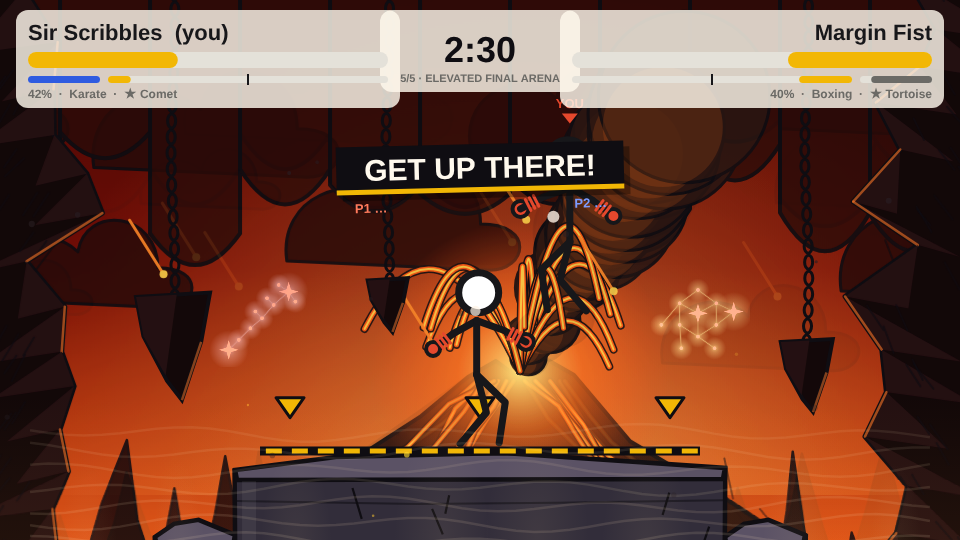
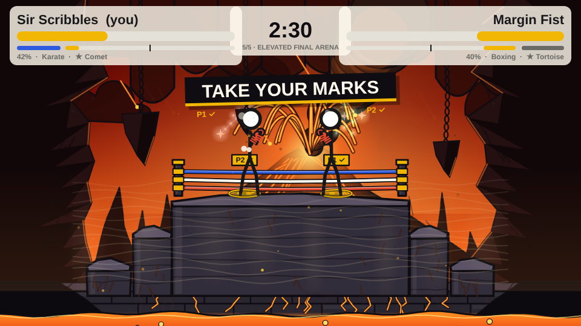
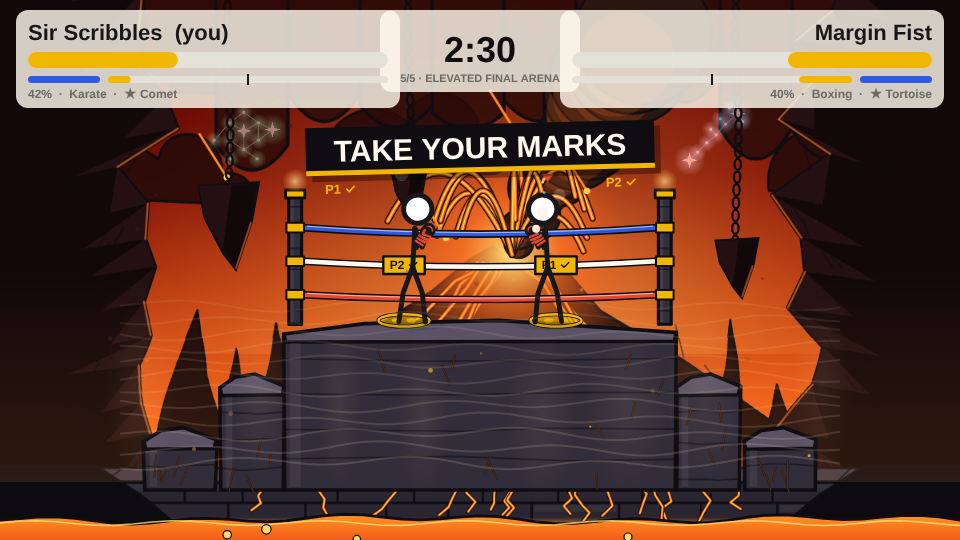
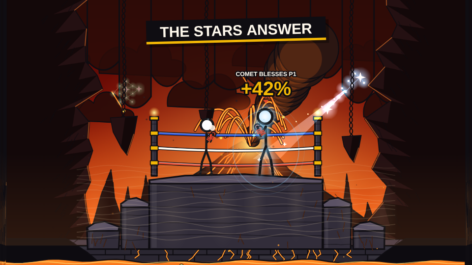
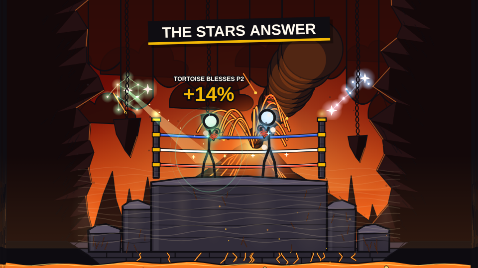
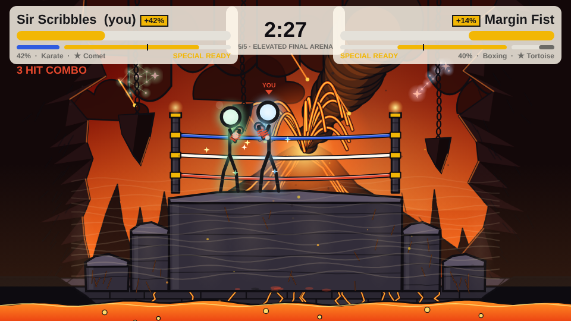

Phone:

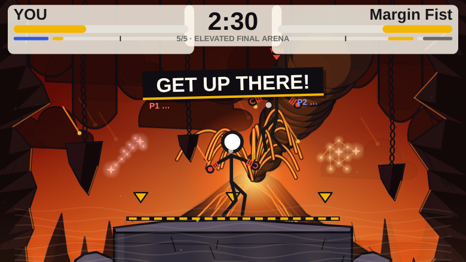
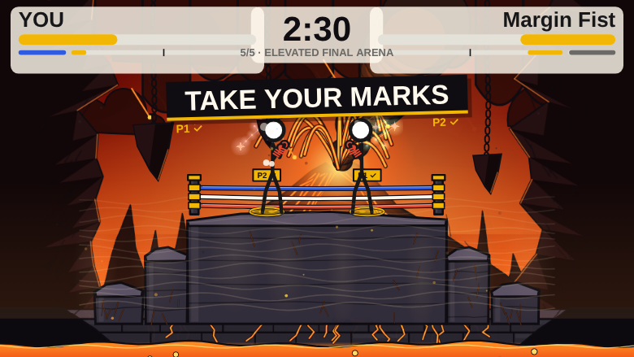
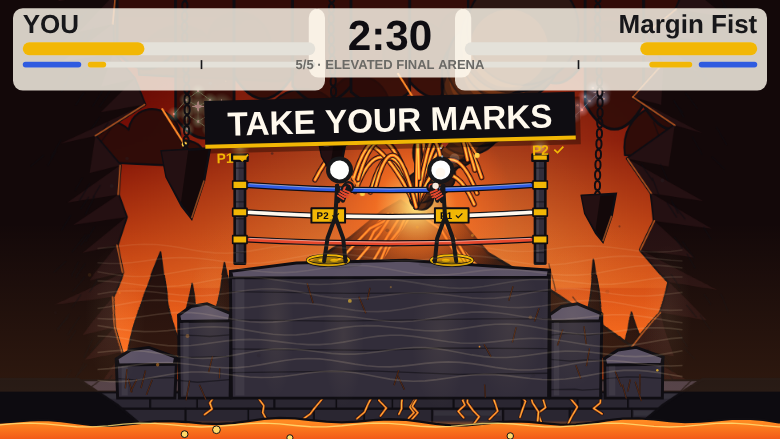
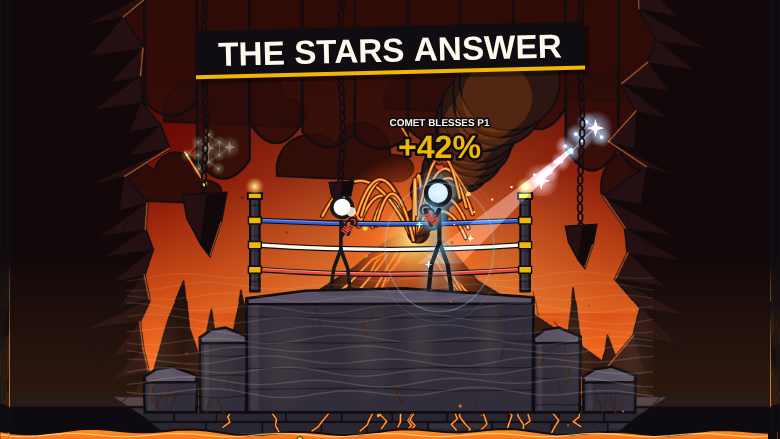
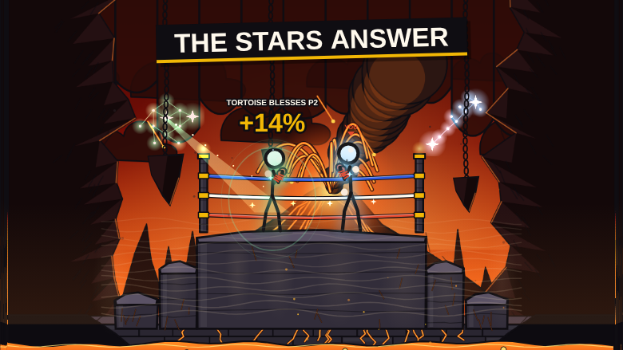
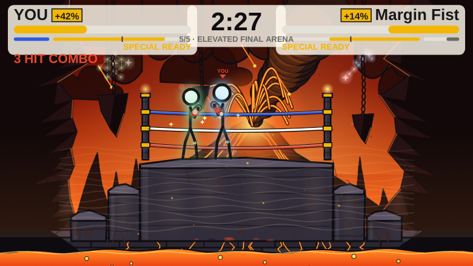

## 2. Decisions (everything the sheet left open, with the values chosen)

All numbers are in `ARENA_TUNE` (`src/game/arena.ts`).

A1. **`Match.cue` has more than `{text, until, target?}`**: an `id` (the renderer, the CPU and the story key off it), `hold` (linger), `done` (who is in place) and
    `fin` (when both were). `until` is ticks into the cue. A mark is `{x, y, r}`, not just an x: the floor under the final platform has the same x.
A2. **The match clock holds, the world clock doesn't.** The stairs must rise while the fight is paused, but every scene, hazard and the 5:00 are on the match
    clock. One extra counter (`pause`) is the whole cost.
A3. **The final platform can't be landed on while it rises** (steps still can: a fighter on one is carried up, as in pass 1). It comes up through the middle of
    the floor, and carrying whoever stood there would have made "Get up there!" a free elevator ride (the first run of the test did exactly that).
A4. **Timeout lifts, never waits for ever.** 25 s; a fighter still below is placed on the platform (puff and sound). The computer never needs it (a failure
    in `scripts/arena.ts` if it does), a human who is lost or AFK doesn't hold the match.
A5. **The staircase rises in 6.5 s** instead of 21 s: the pause is the story beat, so there is no reason to spread the rocks over 20 s. Geometry unchanged.
A6. **Jump is allowed in a pause, drop-through isn't** (guard is off), nothing else is.
A7. **`scripts/arena.ts` runs 300 fights per class pair by default** (about 5 minutes in all). At 100 (±10%) a pair that is really 55% reads 65%+ often enough
    to fail a good build (it happened on the first run of this sprint: Sword-Tank 67% at 100 fights, 55% at 300).
B1. **The pick is in the snapshot, not the lobby.** `ConstellationId` lives in `protocol.ts` as asked, and `Snapshot.arena.pick` carries it to the guest and to `resumeMatch`. The sheet
    also says "and the lobby", but the pick is made inside the fight, after both players have readied, so the lobby has nothing to carry (an optional field nothing sets would be dead code).
B2. **Two fighters never share a constellation** ("only the two chosen constellations stay in the sky" reads as two different ones). A tie on the same tick goes to P1 (P2's press is consumed).
B3. **A fighter who doesn't choose gets the one under the cursor** after 9 s: nobody holds the match, and the CPU or an AFK player isn't a problem.
B4. **The ceremony is 1.5 s of title card + at most 13.75 s of beats = 15.25 s**; with two players locking quickly it is about 8 s.
B5. **Skills apply to the whole fight** ("all match" for the Hare), not only scene 5; they stack with the scene 5 boost. Phoenix means crack and lava damage only (not meteors or heat).
B6. **The HUD hides during the opening** (no health bars or clock yet), and the pop-ups sit at the screen's corners so the fighters (who start at 28% / 72% of the width) stay visible between them.
B7. **Wording of the skills in the pop-up is generated from `ARENA_TUNE.stars`** (`starInfo`), so retuning a number retunes the text.

C1. **The weather fade is on the world clock** (not the match clock), so it keeps running through a guided pause: scene 5's eruption sky comes in while "Get up there!" holds the fight.
C2. **9 s**, the middle of the sheet's "8-10 s". One curve (smoothstep) for the backdrops and everything that follows the mood.
C3. **The heat doesn't end at scene 3.** It settles to 45% (a hot arena stays hot); the sweat and steam stay. Only the *heatwave* (the peak) belongs to scene 2.
C4. **The warp redraws a band of the backdrop in slices** instead of distorting the whole screen: no blur, no offscreen buffers, about 35 `drawImage` calls a frame while it is on.

D1. **The lava falls over the slab's front face**, not just "streams": the slab is a 52 px wall above the lake, so a fall that spreads into the lake reads as molten rock spilling off the edge of the arena.
D2. **The pool is no wider than the zone.** Bigger pools were asked for; making the drawing bigger than the hurt zone would have made players avoid safe floor (or worse, trust a wrong edge). The extra size is in the glow and the fall.
D3. **Stateless drawing** (the spray, the droplets, the flecks and the ripples are all functions of the clock), so a relayed snapshot that skips frames can't leave anything behind and nothing allocates per frame.

E1. **The final platform is 480 wide, not "bigger" by an unspecified amount:** the stairs and the walls of the screen leave room for 60 px, and 374 px of travel inside the walls is what a fight needs (two reaches and a body).
E2. **The seed.** Without it every match rolls the same buffs; the alternative (Math.random in the sim) is forbidden. The caller picks it. Tests and tools that don't pass one get repeatable rolls.
E3. **The buff is applied as damage factors, not by editing `FighterDef`** (`deriveDef`'s admin buff is baked in at match creation; this one arrives mid-match). Same two halves, and nothing to re-apply after `resumeMatch`.
E4. **The walls are solid 2 s after they start to rise, not at once,** so nobody is snapped sideways while still walking to a mark. The marks' pause lingers 80 ticks, long enough for them to be up.
E5. **Scene 5 has no hazard that can reach a fighter once the ring is up** (the lava rises below it as a picture and as the ending's prop; the rescue is still there if anything ever got someone in it). So hazards are now 8-9% of all damage, not 15-17%:
    `scripts/arena.ts` accepts 5-25% (the 10% floor was this sprint's own pass-1 number, not the sheet's).
E6. **Fighters are 12% smaller in the ring, and the platform's shadow is drawn on the platform** (before it fell on the floor far below). Hitboxes unchanged, as asked.
E7. **The ring entry takes about 15 s** (14.5 on average, 17.1 at the most with the computer: the climb 7.5-10 s, the marks 3 s, the stars 4.5 s). The match clock is held through all of it.
E8. **P1 isn't always on the left in the ring** (the one standing further left takes the left mark), so the stars, the beams and the camera follow the side a fighter stands on, while the HUD keeps P1 on the left.


## 3. Gate output

Local Postgres as in `MEMORY.md`. The balance baseline is `npx tsx scripts/balance.ts 200` on `origin/main` (`0ec289a`), taken in a worktree.

### Part A

```
$ npx tsc --noEmit
exit 0

$ npm run lint

> inkfight@0.1.0 lint
> eslint

exit 0

$ npx tsx scripts/check-sim.ts
check-sim: all good
exit 0

$ npx tsx scripts/arena.ts
weakest fighter (AGI 40, SPD 40): jump apex 106.3 px, 34 ticks in the air, 102 px sideways at walking speed

scene 1-4: the floor (tick 0, 0 s, lava y 540)
200 |||                                                                                          |||
220 |||                                                                                          |||
240 |||                                                                                          |||
260 |||                                                                                          |||
280 |||                                                                                          |||
300 |||                                                                                          |||
320 |||                                                                                          |||
340 |||                                                                                          |||
360 |||                                                                                          |||
380 |||                                                                                          |||
400 |||                                                                                          |||
420 |||                                                                                          |||
440 |||                                                                                          |||
460 |||                                                                                          |||
480 |||##########################################################################################|||
500 |||                                                                                          |||
520 |||                                                                                          |||

scene 4, 5 s before the stairs: dust where they will rise (tick 8760, 146 s, lava y 540)
200 |||                                                                                          |||
220 |||                                                                                          |||
240 |||                                                                                          |||
260 |||                                                                                          |||
280 |||                                                                                          |||
300 |||                                                                                          |||
320 |||                                                                                          |||
340 |||                                                                                          |||
360 |||                                                                                          |||
380 |||                                                                                          |||
400 |||                                                                                          |||
420 |||                                                                                          |||
440 |||                                                                                          |||
460 |||                                                                                          |||
480 |||######::::::::#############################################################::::::::#######|||
500 |||          1                                                                    2          |||
520 |||                                                                                          |||

scene 5, step 1 rising (tick 9030, 151 s, lava y 539)
200 |||                                                                                          |||
220 |||                                                                                          |||
240 |||                                                                                          |||
260 |||                                                                                          |||
280 |||                                                                                          |||
300 |||                                                                                          |||
320 |||                                                                                          |||
340 |||                                                                                          |||
360 |||                                                                                          |||
380 |||                                                                                          |||
400 |||                                                                                          |||
420 |||                                                                                          |||
440 |||      ========                                                             ========       |||
460 |||          1                                                                    2          |||
480 |||################:::::::############################################:::::::################|||
500 |||                   3                                                  4                   |||
520 |||~~~~~~~~~~~~~~~~~~~~~~~~~~~~~~~~~~~~~~~~~~~~~~~~~~~~~~~~~~~~~~~~~~~~~~~~~~~~~~~~~~~~~~~~~~|||

scene 5, steps 1 up, 2 and the final platform warn (tick 9200, 153 s, lava y 535)
200 |||                                                                                          |||
220 |||                                                                                          |||
240 |||                                                                                          |||
260 |||                                                                                          |||
280 |||                                                                                          |||
300 |||                                                                                          |||
320 |||                                                                                          |||
340 |||                =======                                            =======                |||
360 |||                   3                                                  4                   |||
380 |||                                                                                          |||
400 |||      ========                                                             ========       |||
420 |||          1                                                                    2          |||
440 |||                                                                                          |||
460 |||                                                                                          |||
480 |||########################::::::::::::::::::::::::::::::::::::::::::########################|||
500 |||                                             5                                            |||
520 |||~~~~~~~~~~~~~~~~~~~~~~~~~~~~~~~~~~~~~~~~~~~~~~~~~~~~~~~~~~~~~~~~~~~~~~~~~~~~~~~~~~~~~~~~~~|||

scene 5, everything up (tick 9420, 157 s, lava y 530)
200 |||                                                                                          |||
220 |||                                                                                          |||
240 |||                                                                                          |||
260 |||                                                                                          |||
280 |||                        ==========================================                        |||
300 |||                                             5                                            |||
320 |||                                                                                          |||
340 |||                =======                                            =======                |||
360 |||                   3                                                  4                   |||
380 |||                                                                                          |||
400 |||      ========                                                             ========       |||
420 |||          1                                                                    2          |||
440 |||                                                                                          |||
460 |||                                                                                          |||
480 |||##########################################################################################|||
500 |||                                                                                          |||
520 |||~~~~~~~~~~~~~~~~~~~~~~~~~~~~~~~~~~~~~~~~~~~~~~~~~~~~~~~~~~~~~~~~~~~~~~~~~~~~~~~~~~~~~~~~~~|||

5:00, lava at its highest (tick 18000, 300 s, lava y 315)
200 |||                                                                                          |||
220 |||                                                                                          |||
240 |||                                                                                          |||
260 |||                                                                                          |||
280 |||                        ==========================================                        |||
300 |||~~~~~~~~~~~~~~~~~~~~~~~~~~~~~~~~~~~~~~~~~~~~~5~~~~~~~~~~~~~~~~~~~~~~~~~~~~~~~~~~~~~~~~~~~~|||
320 |||~~~~~~~~~~~~~~~~~~~~~~~~~~~~~~~~~~~~~~~~~~~~~~~~~~~~~~~~~~~~~~~~~~~~~~~~~~~~~~~~~~~~~~~~~~|||
340 |||~~~~~~~~~~~~~~~~=======~~~~~~~~~~~~~~~~~~~~~~~~~~~~~~~~~~~~~~~~~~~~=======~~~~~~~~~~~~~~~~|||
360 |||~~~~~~~~~~~~~~~~~~~3~~~~~~~~~~~~~~~~~~~~~~~~~~~~~~~~~~~~~~~~~~~~~~~~~~4~~~~~~~~~~~~~~~~~~~|||
380 |||~~~~~~~~~~~~~~~~~~~~~~~~~~~~~~~~~~~~~~~~~~~~~~~~~~~~~~~~~~~~~~~~~~~~~~~~~~~~~~~~~~~~~~~~~~|||
400 |||~~~~~~========~~~~~~~~~~~~~~~~~~~~~~~~~~~~~~~~~~~~~~~~~~~~~~~~~~~~~~~~~~~~~========~~~~~~~|||
420 |||~~~~~~~~~~1~~~~~~~~~~~~~~~~~~~~~~~~~~~~~~~~~~~~~~~~~~~~~~~~~~~~~~~~~~~~~~~~~~~~2~~~~~~~~~~|||
440 |||~~~~~~~~~~~~~~~~~~~~~~~~~~~~~~~~~~~~~~~~~~~~~~~~~~~~~~~~~~~~~~~~~~~~~~~~~~~~~~~~~~~~~~~~~~|||
460 |||~~~~~~~~~~~~~~~~~~~~~~~~~~~~~~~~~~~~~~~~~~~~~~~~~~~~~~~~~~~~~~~~~~~~~~~~~~~~~~~~~~~~~~~~~~|||
480 |||##########################################################################################|||
500 |||~~~~~~~~~~~~~~~~~~~~~~~~~~~~~~~~~~~~~~~~~~~~~~~~~~~~~~~~~~~~~~~~~~~~~~~~~~~~~~~~~~~~~~~~~~|||
520 |||~~~~~~~~~~~~~~~~~~~~~~~~~~~~~~~~~~~~~~~~~~~~~~~~~~~~~~~~~~~~~~~~~~~~~~~~~~~~~~~~~~~~~~~~~~|||

layout asserts
  rises <= 69.1 (staircase: 66, 66, 133, 133), gaps <= 70.0, final platform 420 px wide (380 needed), 200 px up. ok

the climb pause with the real sim (nobody fights; both fighters are computer-driven):
  AGI 40 / SPD 40: 65:8.2s 100:8.1s 150:10.7s 230:7.6s 300:9.9s 480:9.3s 650:9.8s 740:7.5s 810:10.7s 895:8.2s
  AGI 100 / SPD 100: 65:7.8s 100:7.8s 150:7.9s 230:7.7s 300:7.7s 480:7.7s 650:7.7s 740:7.7s 810:7.9s 895:7.8s
  AGI 70 / SPD 40: 65:7.9s 100:7.8s 150:7.5s 230:7.5s 300:7.5s 480:7.5s 650:7.5s 740:7.7s 810:7.5s 895:7.9s

CPU vs CPU, normal level: 220 arena fights over 15 class pairs, both seats
  19 s. ended by KO 210, by the clock 10 (draws 0); average 310 s of play (the clock holds during hit-stop)
  fighters in scene 5: 430/440; still fighting 10 s after the stairs stood: 430; of those on the final platform at some point: 100.0% (both fighters of a fight: 100.0% of 215)
  fighters lifted onto the final platform by a pause timeout: 0
  hazards dealt 16.6% of all damage (237419 of 1433947)

CPU vs CPU, hard level: 300 fights per class pair (±6%)
  247 s. Sword-Mace 53%, Sword-Tank 55%, Sword-Attacker 51%, Sword-Fighter 56%, Mace-Tank 41%, Mace-Attacker 57%, Mace-Fighter 40%, Tank-Attacker 52%, Tank-Fighter 55%, Attacker-Fighter 44%
  fair: every pair within 40-57% (target 35-65%)

determinism: the first 6 fights replay identically

ok: all arena checks passed (scenes: ARRIVAL > HEATWAVE > GROUND FRACTURE > VOLCANIC WARNING > ELEVATED FINAL ARENA)
exit 0

$ npx tsx scripts/balance.ts 200
win rate of row vs column (hard CPU, default kits, 200 matches each) · avg round length
         Sword     | Mace      | Tank      | Attacker  | Fighter  
Sword     51% 23s |  55% 23s |  59% 29s |  39% 18s |  51% 25s
Mace      49% 22s |  55% 23s |  56% 28s |  44% 19s |  51% 24s
Tank      40% 29s |  44% 29s |  51% 40s |  56% 26s |  58% 30s
Attacker  58% 19s |  54% 19s |  45% 26s |  51% 16s |  43% 20s
Fighter   56% 24s |  55% 24s |  39% 30s |  59% 20s |  41% 25s
pairs (400 matches each, ±2.5%): Sword-Mace 53%, Sword-Tank 60%, Sword-Attacker 41%, Sword-Fighter 48%, Mace-Tank 56%, Mace-Attacker 45%, Mace-Fighter 48%, Tank-Attacker 56%, Tank-Fighter 60%, Attacker-Fighter 42%
fair: every pair within 41-60%

stat line vs all-70 (200 kits, 2 matches each): one stat at 100, the other four ~62
STR 53%  ·  DUR 52%  ·  SPD 55%  ·  AGI 50%  ·  IQ 50%
ok: every stat line within 45-62%
exit 0

balance diff vs main: empty (identical)
```

(`npx tsx scripts/arena.ts` with the default 300 fights per pair; the climb, layout, CPU and determinism sections are in the output.)

### Part B

```
$ npx tsc --noEmit
exit 0

$ npm run lint

> inkfight@0.1.0 lint
> eslint

exit 0

$ npx tsx scripts/check-sim.ts
check-sim: all good
exit 0

$ npx tsx scripts/arena.ts
weakest fighter (AGI 40, SPD 40): jump apex 106.3 px, 34 ticks in the air, 102 px sideways at walking speed

scene 1-4: the floor (tick 0, 0 s, lava y 540)
200 |||                                                                                          |||
220 |||                                                                                          |||
240 |||                                                                                          |||
260 |||                                                                                          |||
280 |||                                                                                          |||
300 |||                                                                                          |||
320 |||                                                                                          |||
340 |||                                                                                          |||
360 |||                                                                                          |||
380 |||                                                                                          |||
400 |||                                                                                          |||
420 |||                                                                                          |||
440 |||                                                                                          |||
460 |||                                                                                          |||
480 |||##########################################################################################|||
500 |||                                                                                          |||
520 |||                                                                                          |||

scene 4, 5 s before the stairs: dust where they will rise (tick 8760, 146 s, lava y 540)
200 |||                                                                                          |||
220 |||                                                                                          |||
240 |||                                                                                          |||
260 |||                                                                                          |||
280 |||                                                                                          |||
300 |||                                                                                          |||
320 |||                                                                                          |||
340 |||                                                                                          |||
360 |||                                                                                          |||
380 |||                                                                                          |||
400 |||                                                                                          |||
420 |||                                                                                          |||
440 |||                                                                                          |||
460 |||                                                                                          |||
480 |||######::::::::#############################################################::::::::#######|||
500 |||          1                                                                    2          |||
520 |||                                                                                          |||

scene 5, step 1 rising (tick 9030, 151 s, lava y 539)
200 |||                                                                                          |||
220 |||                                                                                          |||
240 |||                                                                                          |||
260 |||                                                                                          |||
280 |||                                                                                          |||
300 |||                                                                                          |||
320 |||                                                                                          |||
340 |||                                                                                          |||
360 |||                                                                                          |||
380 |||                                                                                          |||
400 |||                                                                                          |||
420 |||                                                                                          |||
440 |||      ========                                                             ========       |||
460 |||          1                                                                    2          |||
480 |||################:::::::############################################:::::::################|||
500 |||                   3                                                  4                   |||
520 |||~~~~~~~~~~~~~~~~~~~~~~~~~~~~~~~~~~~~~~~~~~~~~~~~~~~~~~~~~~~~~~~~~~~~~~~~~~~~~~~~~~~~~~~~~~|||

scene 5, steps 1 up, 2 and the final platform warn (tick 9200, 153 s, lava y 535)
200 |||                                                                                          |||
220 |||                                                                                          |||
240 |||                                                                                          |||
260 |||                                                                                          |||
280 |||                                                                                          |||
300 |||                                                                                          |||
320 |||                                                                                          |||
340 |||                =======                                            =======                |||
360 |||                   3                                                  4                   |||
380 |||                                                                                          |||
400 |||      ========                                                             ========       |||
420 |||          1                                                                    2          |||
440 |||                                                                                          |||
460 |||                                                                                          |||
480 |||########################::::::::::::::::::::::::::::::::::::::::::########################|||
500 |||                                             5                                            |||
520 |||~~~~~~~~~~~~~~~~~~~~~~~~~~~~~~~~~~~~~~~~~~~~~~~~~~~~~~~~~~~~~~~~~~~~~~~~~~~~~~~~~~~~~~~~~~|||

scene 5, everything up (tick 9420, 157 s, lava y 530)
200 |||                                                                                          |||
220 |||                                                                                          |||
240 |||                                                                                          |||
260 |||                                                                                          |||
280 |||                        ==========================================                        |||
300 |||                                             5                                            |||
320 |||                                                                                          |||
340 |||                =======                                            =======                |||
360 |||                   3                                                  4                   |||
380 |||                                                                                          |||
400 |||      ========                                                             ========       |||
420 |||          1                                                                    2          |||
440 |||                                                                                          |||
460 |||                                                                                          |||
480 |||##########################################################################################|||
500 |||                                                                                          |||
520 |||~~~~~~~~~~~~~~~~~~~~~~~~~~~~~~~~~~~~~~~~~~~~~~~~~~~~~~~~~~~~~~~~~~~~~~~~~~~~~~~~~~~~~~~~~~|||

5:00, lava at its highest (tick 18000, 300 s, lava y 315)
200 |||                                                                                          |||
220 |||                                                                                          |||
240 |||                                                                                          |||
260 |||                                                                                          |||
280 |||                        ==========================================                        |||
300 |||~~~~~~~~~~~~~~~~~~~~~~~~~~~~~~~~~~~~~~~~~~~~~5~~~~~~~~~~~~~~~~~~~~~~~~~~~~~~~~~~~~~~~~~~~~|||
320 |||~~~~~~~~~~~~~~~~~~~~~~~~~~~~~~~~~~~~~~~~~~~~~~~~~~~~~~~~~~~~~~~~~~~~~~~~~~~~~~~~~~~~~~~~~~|||
340 |||~~~~~~~~~~~~~~~~=======~~~~~~~~~~~~~~~~~~~~~~~~~~~~~~~~~~~~~~~~~~~~=======~~~~~~~~~~~~~~~~|||
360 |||~~~~~~~~~~~~~~~~~~~3~~~~~~~~~~~~~~~~~~~~~~~~~~~~~~~~~~~~~~~~~~~~~~~~~~4~~~~~~~~~~~~~~~~~~~|||
380 |||~~~~~~~~~~~~~~~~~~~~~~~~~~~~~~~~~~~~~~~~~~~~~~~~~~~~~~~~~~~~~~~~~~~~~~~~~~~~~~~~~~~~~~~~~~|||
400 |||~~~~~~========~~~~~~~~~~~~~~~~~~~~~~~~~~~~~~~~~~~~~~~~~~~~~~~~~~~~~~~~~~~~~========~~~~~~~|||
420 |||~~~~~~~~~~1~~~~~~~~~~~~~~~~~~~~~~~~~~~~~~~~~~~~~~~~~~~~~~~~~~~~~~~~~~~~~~~~~~~~2~~~~~~~~~~|||
440 |||~~~~~~~~~~~~~~~~~~~~~~~~~~~~~~~~~~~~~~~~~~~~~~~~~~~~~~~~~~~~~~~~~~~~~~~~~~~~~~~~~~~~~~~~~~|||
460 |||~~~~~~~~~~~~~~~~~~~~~~~~~~~~~~~~~~~~~~~~~~~~~~~~~~~~~~~~~~~~~~~~~~~~~~~~~~~~~~~~~~~~~~~~~~|||
480 |||##########################################################################################|||
500 |||~~~~~~~~~~~~~~~~~~~~~~~~~~~~~~~~~~~~~~~~~~~~~~~~~~~~~~~~~~~~~~~~~~~~~~~~~~~~~~~~~~~~~~~~~~|||
520 |||~~~~~~~~~~~~~~~~~~~~~~~~~~~~~~~~~~~~~~~~~~~~~~~~~~~~~~~~~~~~~~~~~~~~~~~~~~~~~~~~~~~~~~~~~~|||

layout asserts
  rises <= 69.1 (staircase: 66, 66, 133, 133), gaps <= 70.0, final platform 420 px wide (380 needed), 200 px up. ok

the climb pause with the real sim (nobody fights; both fighters are computer-driven):
  AGI 40 / SPD 40: 65:8.2s 100:8.1s 150:10.7s 230:7.6s 300:9.9s 480:9.3s 650:9.8s 740:7.5s 810:10.7s 895:8.2s
  AGI 100 / SPD 100: 65:7.8s 100:7.8s 150:7.9s 230:7.7s 300:7.7s 480:7.7s 650:7.7s 740:7.7s 810:7.9s 895:7.8s
  AGI 70 / SPD 40: 65:7.9s 100:7.8s 150:7.5s 230:7.5s 300:7.5s 480:7.5s 650:7.5s 740:7.7s 810:7.5s 895:7.9s

CPU vs CPU, normal level: 220 arena fights over 15 class pairs, both seats
  22 s. ended by KO 204, by the clock 16 (draws 0); average 320 s of play (the clock holds during hit-stop)
  fighters in scene 5: 426/440; still fighting 10 s after the stairs stood: 422; of those on the final platform at some point: 100.0% (both fighters of a fight: 100.0% of 211)
  opening ceremony: 8.6 s on average, 9.6 s at the most (the sheet: first 15 s); the computer picked comet 20%, hare 20%, phoenix 22%, serpent 18%, tortoise 21%; two fighters on one constellation: 0
  fighters lifted onto the final platform by a pause timeout: 0
  hazards dealt 15.3% of all damage (219894 of 1434448)

CPU vs CPU, hard level: 300 fights per class pair (±6%)
  261 s. Sword-Mace 54%, Sword-Tank 48%, Sword-Attacker 50%, Sword-Fighter 54%, Mace-Tank 41%, Mace-Attacker 55%, Mace-Fighter 44%, Tank-Attacker 52%, Tank-Fighter 54%, Attacker-Fighter 47%
  fair: every pair within 41-55% (target 35-65%)

determinism: the first 6 fights replay identically

ok: all arena checks passed (scenes: ARRIVAL > HEATWAVE > GROUND FRACTURE > VOLCANIC WARNING > ELEVATED FINAL ARENA)
exit 0

$ npx tsx scripts/balance.ts 200
win rate of row vs column (hard CPU, default kits, 200 matches each) · avg round length
         Sword     | Mace      | Tank      | Attacker  | Fighter  
Sword     51% 23s |  55% 23s |  59% 29s |  39% 18s |  51% 25s
Mace      49% 22s |  55% 23s |  56% 28s |  44% 19s |  51% 24s
Tank      40% 29s |  44% 29s |  51% 40s |  56% 26s |  58% 30s
Attacker  58% 19s |  54% 19s |  45% 26s |  51% 16s |  43% 20s
Fighter   56% 24s |  55% 24s |  39% 30s |  59% 20s |  41% 25s
pairs (400 matches each, ±2.5%): Sword-Mace 53%, Sword-Tank 60%, Sword-Attacker 41%, Sword-Fighter 48%, Mace-Tank 56%, Mace-Attacker 45%, Mace-Fighter 48%, Tank-Attacker 56%, Tank-Fighter 60%, Attacker-Fighter 42%
fair: every pair within 41-60%

stat line vs all-70 (200 kits, 2 matches each): one stat at 100, the other four ~62
STR 53%  ·  DUR 52%  ·  SPD 55%  ·  AGI 50%  ·  IQ 50%
ok: every stat line within 45-62%
exit 0

balance diff vs main: empty (identical)
```

### Part C

```
$ npx tsc --noEmit
exit 0

$ npm run lint

> inkfight@0.1.0 lint
> eslint

exit 0

$ npx tsx scripts/check-sim.ts
check-sim: all good
exit 0

$ npx tsx scripts/arena.ts
weakest fighter (AGI 40, SPD 40): jump apex 106.3 px, 34 ticks in the air, 102 px sideways at walking speed

scene 1-4: the floor (tick 0, 0 s, lava y 540)
200 |||                                                                                          |||
220 |||                                                                                          |||
240 |||                                                                                          |||
260 |||                                                                                          |||
280 |||                                                                                          |||
300 |||                                                                                          |||
320 |||                                                                                          |||
340 |||                                                                                          |||
360 |||                                                                                          |||
380 |||                                                                                          |||
400 |||                                                                                          |||
420 |||                                                                                          |||
440 |||                                                                                          |||
460 |||                                                                                          |||
480 |||##########################################################################################|||
500 |||                                                                                          |||
520 |||                                                                                          |||

scene 4, 5 s before the stairs: dust where they will rise (tick 8760, 146 s, lava y 540)
200 |||                                                                                          |||
220 |||                                                                                          |||
240 |||                                                                                          |||
260 |||                                                                                          |||
280 |||                                                                                          |||
300 |||                                                                                          |||
320 |||                                                                                          |||
340 |||                                                                                          |||
360 |||                                                                                          |||
380 |||                                                                                          |||
400 |||                                                                                          |||
420 |||                                                                                          |||
440 |||                                                                                          |||
460 |||                                                                                          |||
480 |||######::::::::#############################################################::::::::#######|||
500 |||          1                                                                    2          |||
520 |||                                                                                          |||

scene 5, step 1 rising (tick 9030, 151 s, lava y 539)
200 |||                                                                                          |||
220 |||                                                                                          |||
240 |||                                                                                          |||
260 |||                                                                                          |||
280 |||                                                                                          |||
300 |||                                                                                          |||
320 |||                                                                                          |||
340 |||                                                                                          |||
360 |||                                                                                          |||
380 |||                                                                                          |||
400 |||                                                                                          |||
420 |||                                                                                          |||
440 |||      ========                                                             ========       |||
460 |||          1                                                                    2          |||
480 |||################:::::::############################################:::::::################|||
500 |||                   3                                                  4                   |||
520 |||~~~~~~~~~~~~~~~~~~~~~~~~~~~~~~~~~~~~~~~~~~~~~~~~~~~~~~~~~~~~~~~~~~~~~~~~~~~~~~~~~~~~~~~~~~|||

scene 5, steps 1 up, 2 and the final platform warn (tick 9200, 153 s, lava y 535)
200 |||                                                                                          |||
220 |||                                                                                          |||
240 |||                                                                                          |||
260 |||                                                                                          |||
280 |||                                                                                          |||
300 |||                                                                                          |||
320 |||                                                                                          |||
340 |||                =======                                            =======                |||
360 |||                   3                                                  4                   |||
380 |||                                                                                          |||
400 |||      ========                                                             ========       |||
420 |||          1                                                                    2          |||
440 |||                                                                                          |||
460 |||                                                                                          |||
480 |||########################::::::::::::::::::::::::::::::::::::::::::########################|||
500 |||                                             5                                            |||
520 |||~~~~~~~~~~~~~~~~~~~~~~~~~~~~~~~~~~~~~~~~~~~~~~~~~~~~~~~~~~~~~~~~~~~~~~~~~~~~~~~~~~~~~~~~~~|||

scene 5, everything up (tick 9420, 157 s, lava y 530)
200 |||                                                                                          |||
220 |||                                                                                          |||
240 |||                                                                                          |||
260 |||                                                                                          |||
280 |||                        ==========================================                        |||
300 |||                                             5                                            |||
320 |||                                                                                          |||
340 |||                =======                                            =======                |||
360 |||                   3                                                  4                   |||
380 |||                                                                                          |||
400 |||      ========                                                             ========       |||
420 |||          1                                                                    2          |||
440 |||                                                                                          |||
460 |||                                                                                          |||
480 |||##########################################################################################|||
500 |||                                                                                          |||
520 |||~~~~~~~~~~~~~~~~~~~~~~~~~~~~~~~~~~~~~~~~~~~~~~~~~~~~~~~~~~~~~~~~~~~~~~~~~~~~~~~~~~~~~~~~~~|||

5:00, lava at its highest (tick 18000, 300 s, lava y 315)
200 |||                                                                                          |||
220 |||                                                                                          |||
240 |||                                                                                          |||
260 |||                                                                                          |||
280 |||                        ==========================================                        |||
300 |||~~~~~~~~~~~~~~~~~~~~~~~~~~~~~~~~~~~~~~~~~~~~~5~~~~~~~~~~~~~~~~~~~~~~~~~~~~~~~~~~~~~~~~~~~~|||
320 |||~~~~~~~~~~~~~~~~~~~~~~~~~~~~~~~~~~~~~~~~~~~~~~~~~~~~~~~~~~~~~~~~~~~~~~~~~~~~~~~~~~~~~~~~~~|||
340 |||~~~~~~~~~~~~~~~~=======~~~~~~~~~~~~~~~~~~~~~~~~~~~~~~~~~~~~~~~~~~~~=======~~~~~~~~~~~~~~~~|||
360 |||~~~~~~~~~~~~~~~~~~~3~~~~~~~~~~~~~~~~~~~~~~~~~~~~~~~~~~~~~~~~~~~~~~~~~~4~~~~~~~~~~~~~~~~~~~|||
380 |||~~~~~~~~~~~~~~~~~~~~~~~~~~~~~~~~~~~~~~~~~~~~~~~~~~~~~~~~~~~~~~~~~~~~~~~~~~~~~~~~~~~~~~~~~~|||
400 |||~~~~~~========~~~~~~~~~~~~~~~~~~~~~~~~~~~~~~~~~~~~~~~~~~~~~~~~~~~~~~~~~~~~~========~~~~~~~|||
420 |||~~~~~~~~~~1~~~~~~~~~~~~~~~~~~~~~~~~~~~~~~~~~~~~~~~~~~~~~~~~~~~~~~~~~~~~~~~~~~~~2~~~~~~~~~~|||
440 |||~~~~~~~~~~~~~~~~~~~~~~~~~~~~~~~~~~~~~~~~~~~~~~~~~~~~~~~~~~~~~~~~~~~~~~~~~~~~~~~~~~~~~~~~~~|||
460 |||~~~~~~~~~~~~~~~~~~~~~~~~~~~~~~~~~~~~~~~~~~~~~~~~~~~~~~~~~~~~~~~~~~~~~~~~~~~~~~~~~~~~~~~~~~|||
480 |||##########################################################################################|||
500 |||~~~~~~~~~~~~~~~~~~~~~~~~~~~~~~~~~~~~~~~~~~~~~~~~~~~~~~~~~~~~~~~~~~~~~~~~~~~~~~~~~~~~~~~~~~|||
520 |||~~~~~~~~~~~~~~~~~~~~~~~~~~~~~~~~~~~~~~~~~~~~~~~~~~~~~~~~~~~~~~~~~~~~~~~~~~~~~~~~~~~~~~~~~~|||

layout asserts
  rises <= 69.1 (staircase: 66, 66, 133, 133), gaps <= 70.0, final platform 420 px wide (380 needed), 200 px up. ok

the climb pause with the real sim (nobody fights; both fighters are computer-driven):
  AGI 40 / SPD 40: 65:8.2s 100:8.1s 150:10.7s 230:7.6s 300:9.9s 480:9.3s 650:9.8s 740:7.5s 810:10.7s 895:8.2s
  AGI 100 / SPD 100: 65:7.8s 100:7.8s 150:7.9s 230:7.7s 300:7.7s 480:7.7s 650:7.7s 740:7.7s 810:7.9s 895:7.8s
  AGI 70 / SPD 40: 65:7.9s 100:7.8s 150:7.5s 230:7.5s 300:7.5s 480:7.5s 650:7.5s 740:7.7s 810:7.5s 895:7.9s

CPU vs CPU, normal level: 220 arena fights over 15 class pairs, both seats
  22 s. ended by KO 204, by the clock 16 (draws 0); average 320 s of play (the clock holds during hit-stop)
  fighters in scene 5: 426/440; still fighting 10 s after the stairs stood: 422; of those on the final platform at some point: 100.0% (both fighters of a fight: 100.0% of 211)
  opening ceremony: 8.6 s on average, 9.6 s at the most (the sheet: first 15 s); the computer picked comet 20%, hare 20%, phoenix 22%, serpent 18%, tortoise 21%; two fighters on one constellation: 0
  fighters lifted onto the final platform by a pause timeout: 0
  hazards dealt 15.3% of all damage (219894 of 1434448)

CPU vs CPU, hard level: 300 fights per class pair (±6%)
  261 s. Sword-Mace 54%, Sword-Tank 48%, Sword-Attacker 50%, Sword-Fighter 54%, Mace-Tank 41%, Mace-Attacker 55%, Mace-Fighter 44%, Tank-Attacker 52%, Tank-Fighter 54%, Attacker-Fighter 47%
  fair: every pair within 41-55% (target 35-65%)

determinism: the first 6 fights replay identically

ok: all arena checks passed (scenes: ARRIVAL > HEATWAVE > GROUND FRACTURE > VOLCANIC WARNING > ELEVATED FINAL ARENA)
exit 0

$ npx tsx scripts/balance.ts 200
win rate of row vs column (hard CPU, default kits, 200 matches each) · avg round length
         Sword     | Mace      | Tank      | Attacker  | Fighter  
Sword     51% 23s |  55% 23s |  59% 29s |  39% 18s |  51% 25s
Mace      49% 22s |  55% 23s |  56% 28s |  44% 19s |  51% 24s
Tank      40% 29s |  44% 29s |  51% 40s |  56% 26s |  58% 30s
Attacker  58% 19s |  54% 19s |  45% 26s |  51% 16s |  43% 20s
Fighter   56% 24s |  55% 24s |  39% 30s |  59% 20s |  41% 25s
pairs (400 matches each, ±2.5%): Sword-Mace 53%, Sword-Tank 60%, Sword-Attacker 41%, Sword-Fighter 48%, Mace-Tank 56%, Mace-Attacker 45%, Mace-Fighter 48%, Tank-Attacker 56%, Tank-Fighter 60%, Attacker-Fighter 42%
fair: every pair within 41-60%

stat line vs all-70 (200 kits, 2 matches each): one stat at 100, the other four ~62
STR 53%  ·  DUR 52%  ·  SPD 55%  ·  AGI 50%  ·  IQ 50%
ok: every stat line within 45-62%
exit 0

balance diff vs main: empty (identical)
```

### Part D

```
$ npx tsc --noEmit
exit 0

$ npm run lint

> inkfight@0.1.0 lint
> eslint

exit 0

$ npx tsx scripts/check-sim.ts
check-sim: all good
exit 0

$ npx tsx scripts/arena.ts
weakest fighter (AGI 40, SPD 40): jump apex 106.3 px, 34 ticks in the air, 102 px sideways at walking speed

scene 1-4: the floor (tick 0, 0 s, lava y 540)
200 |||                                                                                          |||
220 |||                                                                                          |||
240 |||                                                                                          |||
260 |||                                                                                          |||
280 |||                                                                                          |||
300 |||                                                                                          |||
320 |||                                                                                          |||
340 |||                                                                                          |||
360 |||                                                                                          |||
380 |||                                                                                          |||
400 |||                                                                                          |||
420 |||                                                                                          |||
440 |||                                                                                          |||
460 |||                                                                                          |||
480 |||##########################################################################################|||
500 |||                                                                                          |||
520 |||                                                                                          |||

scene 4, 5 s before the stairs: dust where they will rise (tick 8760, 146 s, lava y 540)
200 |||                                                                                          |||
220 |||                                                                                          |||
240 |||                                                                                          |||
260 |||                                                                                          |||
280 |||                                                                                          |||
300 |||                                                                                          |||
320 |||                                                                                          |||
340 |||                                                                                          |||
360 |||                                                                                          |||
380 |||                                                                                          |||
400 |||                                                                                          |||
420 |||                                                                                          |||
440 |||                                                                                          |||
460 |||                                                                                          |||
480 |||######::::::::#############################################################::::::::#######|||
500 |||          1                                                                    2          |||
520 |||                                                                                          |||

scene 5, step 1 rising (tick 9030, 151 s, lava y 539)
200 |||                                                                                          |||
220 |||                                                                                          |||
240 |||                                                                                          |||
260 |||                                                                                          |||
280 |||                                                                                          |||
300 |||                                                                                          |||
320 |||                                                                                          |||
340 |||                                                                                          |||
360 |||                                                                                          |||
380 |||                                                                                          |||
400 |||                                                                                          |||
420 |||                                                                                          |||
440 |||      ========                                                             ========       |||
460 |||          1                                                                    2          |||
480 |||################:::::::############################################:::::::################|||
500 |||                   3                                                  4                   |||
520 |||~~~~~~~~~~~~~~~~~~~~~~~~~~~~~~~~~~~~~~~~~~~~~~~~~~~~~~~~~~~~~~~~~~~~~~~~~~~~~~~~~~~~~~~~~~|||

scene 5, steps 1 up, 2 and the final platform warn (tick 9200, 153 s, lava y 535)
200 |||                                                                                          |||
220 |||                                                                                          |||
240 |||                                                                                          |||
260 |||                                                                                          |||
280 |||                                                                                          |||
300 |||                                                                                          |||
320 |||                                                                                          |||
340 |||                =======                                            =======                |||
360 |||                   3                                                  4                   |||
380 |||                                                                                          |||
400 |||      ========                                                             ========       |||
420 |||          1                                                                    2          |||
440 |||                                                                                          |||
460 |||                                                                                          |||
480 |||########################::::::::::::::::::::::::::::::::::::::::::########################|||
500 |||                                             5                                            |||
520 |||~~~~~~~~~~~~~~~~~~~~~~~~~~~~~~~~~~~~~~~~~~~~~~~~~~~~~~~~~~~~~~~~~~~~~~~~~~~~~~~~~~~~~~~~~~|||

scene 5, everything up (tick 9420, 157 s, lava y 530)
200 |||                                                                                          |||
220 |||                                                                                          |||
240 |||                                                                                          |||
260 |||                                                                                          |||
280 |||                        ==========================================                        |||
300 |||                                             5                                            |||
320 |||                                                                                          |||
340 |||                =======                                            =======                |||
360 |||                   3                                                  4                   |||
380 |||                                                                                          |||
400 |||      ========                                                             ========       |||
420 |||          1                                                                    2          |||
440 |||                                                                                          |||
460 |||                                                                                          |||
480 |||##########################################################################################|||
500 |||                                                                                          |||
520 |||~~~~~~~~~~~~~~~~~~~~~~~~~~~~~~~~~~~~~~~~~~~~~~~~~~~~~~~~~~~~~~~~~~~~~~~~~~~~~~~~~~~~~~~~~~|||

5:00, lava at its highest (tick 18000, 300 s, lava y 315)
200 |||                                                                                          |||
220 |||                                                                                          |||
240 |||                                                                                          |||
260 |||                                                                                          |||
280 |||                        ==========================================                        |||
300 |||~~~~~~~~~~~~~~~~~~~~~~~~~~~~~~~~~~~~~~~~~~~~~5~~~~~~~~~~~~~~~~~~~~~~~~~~~~~~~~~~~~~~~~~~~~|||
320 |||~~~~~~~~~~~~~~~~~~~~~~~~~~~~~~~~~~~~~~~~~~~~~~~~~~~~~~~~~~~~~~~~~~~~~~~~~~~~~~~~~~~~~~~~~~|||
340 |||~~~~~~~~~~~~~~~~=======~~~~~~~~~~~~~~~~~~~~~~~~~~~~~~~~~~~~~~~~~~~~=======~~~~~~~~~~~~~~~~|||
360 |||~~~~~~~~~~~~~~~~~~~3~~~~~~~~~~~~~~~~~~~~~~~~~~~~~~~~~~~~~~~~~~~~~~~~~~4~~~~~~~~~~~~~~~~~~~|||
380 |||~~~~~~~~~~~~~~~~~~~~~~~~~~~~~~~~~~~~~~~~~~~~~~~~~~~~~~~~~~~~~~~~~~~~~~~~~~~~~~~~~~~~~~~~~~|||
400 |||~~~~~~========~~~~~~~~~~~~~~~~~~~~~~~~~~~~~~~~~~~~~~~~~~~~~~~~~~~~~~~~~~~~~========~~~~~~~|||
420 |||~~~~~~~~~~1~~~~~~~~~~~~~~~~~~~~~~~~~~~~~~~~~~~~~~~~~~~~~~~~~~~~~~~~~~~~~~~~~~~~2~~~~~~~~~~|||
440 |||~~~~~~~~~~~~~~~~~~~~~~~~~~~~~~~~~~~~~~~~~~~~~~~~~~~~~~~~~~~~~~~~~~~~~~~~~~~~~~~~~~~~~~~~~~|||
460 |||~~~~~~~~~~~~~~~~~~~~~~~~~~~~~~~~~~~~~~~~~~~~~~~~~~~~~~~~~~~~~~~~~~~~~~~~~~~~~~~~~~~~~~~~~~|||
480 |||##########################################################################################|||
500 |||~~~~~~~~~~~~~~~~~~~~~~~~~~~~~~~~~~~~~~~~~~~~~~~~~~~~~~~~~~~~~~~~~~~~~~~~~~~~~~~~~~~~~~~~~~|||
520 |||~~~~~~~~~~~~~~~~~~~~~~~~~~~~~~~~~~~~~~~~~~~~~~~~~~~~~~~~~~~~~~~~~~~~~~~~~~~~~~~~~~~~~~~~~~|||

layout asserts
  rises <= 69.1 (staircase: 66, 66, 133, 133), gaps <= 70.0, final platform 420 px wide (380 needed), 200 px up. ok

the climb pause with the real sim (nobody fights; both fighters are computer-driven):
  AGI 40 / SPD 40: 65:8.2s 100:8.1s 150:10.7s 230:7.6s 300:9.9s 480:9.3s 650:9.8s 740:7.5s 810:10.7s 895:8.2s
  AGI 100 / SPD 100: 65:7.8s 100:7.8s 150:7.9s 230:7.7s 300:7.7s 480:7.7s 650:7.7s 740:7.7s 810:7.9s 895:7.8s
  AGI 70 / SPD 40: 65:7.9s 100:7.8s 150:7.5s 230:7.5s 300:7.5s 480:7.5s 650:7.5s 740:7.7s 810:7.5s 895:7.9s

CPU vs CPU, normal level: 220 arena fights over 15 class pairs, both seats
  22 s. ended by KO 204, by the clock 16 (draws 0); average 320 s of play (the clock holds during hit-stop)
  fighters in scene 5: 426/440; still fighting 10 s after the stairs stood: 422; of those on the final platform at some point: 100.0% (both fighters of a fight: 100.0% of 211)
  opening ceremony: 8.6 s on average, 9.6 s at the most (the sheet: first 15 s); the computer picked comet 20%, hare 20%, phoenix 22%, serpent 18%, tortoise 21%; two fighters on one constellation: 0
  fighters lifted onto the final platform by a pause timeout: 0
  hazards dealt 15.3% of all damage (219894 of 1434448)

CPU vs CPU, hard level: 300 fights per class pair (±6%)
  256 s. Sword-Mace 54%, Sword-Tank 48%, Sword-Attacker 50%, Sword-Fighter 54%, Mace-Tank 41%, Mace-Attacker 55%, Mace-Fighter 44%, Tank-Attacker 52%, Tank-Fighter 54%, Attacker-Fighter 47%
  fair: every pair within 41-55% (target 35-65%)

determinism: the first 6 fights replay identically

ok: all arena checks passed (scenes: ARRIVAL > HEATWAVE > GROUND FRACTURE > VOLCANIC WARNING > ELEVATED FINAL ARENA)
exit 0

$ npx tsx scripts/balance.ts 200
win rate of row vs column (hard CPU, default kits, 200 matches each) · avg round length
         Sword     | Mace      | Tank      | Attacker  | Fighter  
Sword     51% 23s |  55% 23s |  59% 29s |  39% 18s |  51% 25s
Mace      49% 22s |  55% 23s |  56% 28s |  44% 19s |  51% 24s
Tank      40% 29s |  44% 29s |  51% 40s |  56% 26s |  58% 30s
Attacker  58% 19s |  54% 19s |  45% 26s |  51% 16s |  43% 20s
Fighter   56% 24s |  55% 24s |  39% 30s |  59% 20s |  41% 25s
pairs (400 matches each, ±2.5%): Sword-Mace 53%, Sword-Tank 60%, Sword-Attacker 41%, Sword-Fighter 48%, Mace-Tank 56%, Mace-Attacker 45%, Mace-Fighter 48%, Tank-Attacker 56%, Tank-Fighter 60%, Attacker-Fighter 42%
fair: every pair within 41-60%

stat line vs all-70 (200 kits, 2 matches each): one stat at 100, the other four ~62
STR 53%  ·  DUR 52%  ·  SPD 55%  ·  AGI 50%  ·  IQ 50%
ok: every stat line within 45-62%
exit 0

balance diff vs main: empty (identical)
```

### Part E

```
$ npx tsc --noEmit
exit 0

$ npm run lint

> inkfight@0.1.0 lint
> eslint

exit 0

$ npx tsx scripts/check-sim.ts
check-sim: all good
exit 0

$ npx tsx scripts/arena.ts
weakest fighter (AGI 40, SPD 40): jump apex 106.3 px, 34 ticks in the air, 102 px sideways at walking speed

scene 1-4: the floor (tick 0, 0 s, lava y 540)
200 |||                                                                                          |||
220 |||                                                                                          |||
240 |||                                                                                          |||
260 |||                                                                                          |||
280 |||                                                                                          |||
300 |||                                                                                          |||
320 |||                                                                                          |||
340 |||                                                                                          |||
360 |||                                                                                          |||
380 |||                                                                                          |||
400 |||                                                                                          |||
420 |||                                                                                          |||
440 |||                                                                                          |||
460 |||                                                                                          |||
480 |||##########################################################################################|||
500 |||                                                                                          |||
520 |||                                                                                          |||

scene 4, 5 s before the stairs: dust where they will rise (tick 8760, 146 s, lava y 540)
200 |||                                                                                          |||
220 |||                                                                                          |||
240 |||                                                                                          |||
260 |||                                                                                          |||
280 |||                                                                                          |||
300 |||                                                                                          |||
320 |||                                                                                          |||
340 |||                                                                                          |||
360 |||                                                                                          |||
380 |||                                                                                          |||
400 |||                                                                                          |||
420 |||                                                                                          |||
440 |||                                                                                          |||
460 |||                                                                                          |||
480 |||###::::::::###################################################################::::::::####|||
500 |||       1                                                                          2       |||
520 |||                                                                                          |||

scene 5, step 1 rising (tick 9030, 151 s, lava y 539)
200 |||                                                                                          |||
220 |||                                                                                          |||
240 |||                                                                                          |||
260 |||                                                                                          |||
280 |||                                                                                          |||
300 |||                                                                                          |||
320 |||                                                                                          |||
340 |||                                                                                          |||
360 |||                                                                                          |||
380 |||                                                                                          |||
400 |||                                                                                          |||
420 |||                                                                                          |||
440 |||   ========                                                                   ========    |||
460 |||       1                                                                          2       |||
480 |||#############:::::::##################################################:::::::#############|||
500 |||                3                                                        4                |||
520 |||~~~~~~~~~~~~~~~~~~~~~~~~~~~~~~~~~~~~~~~~~~~~~~~~~~~~~~~~~~~~~~~~~~~~~~~~~~~~~~~~~~~~~~~~~~|||

scene 5, steps 1 up, 2 and the final platform warn (tick 9200, 153 s, lava y 535)
200 |||                                                                                          |||
220 |||                                                                                          |||
240 |||                                                                                          |||
260 |||                                                                                          |||
280 |||                                                                                          |||
300 |||                                                                                          |||
320 |||                                                                                          |||
340 |||             =======                                                  =======             |||
360 |||                3                                                        4                |||
380 |||                                                                                          |||
400 |||   ========                                                                   ========    |||
420 |||       1                                                                          2       |||
440 |||                                                                                          |||
460 |||                                                                                          |||
480 |||#####################::::::::::::::::::::::::::::::::::::::::::::::::#####################|||
500 |||                                             5                                            |||
520 |||~~~~~~~~~~~~~~~~~~~~~~~~~~~~~~~~~~~~~~~~~~~~~~~~~~~~~~~~~~~~~~~~~~~~~~~~~~~~~~~~~~~~~~~~~~|||

scene 5, everything up (tick 9420, 157 s, lava y 530)
200 |||                                                                                          |||
220 |||                                                                                          |||
240 |||                                                                                          |||
260 |||                                                                                          |||
280 |||                     ================================================                     |||
300 |||                                             5                                            |||
320 |||                                                                                          |||
340 |||             =======                                                  =======             |||
360 |||                3                                                        4                |||
380 |||                                                                                          |||
400 |||   ========                                                                   ========    |||
420 |||       1                                                                          2       |||
440 |||                                                                                          |||
460 |||                                                                                          |||
480 |||##########################################################################################|||
500 |||                                                                                          |||
520 |||~~~~~~~~~~~~~~~~~~~~~~~~~~~~~~~~~~~~~~~~~~~~~~~~~~~~~~~~~~~~~~~~~~~~~~~~~~~~~~~~~~~~~~~~~~|||

5:00, lava at its highest (tick 18000, 300 s, lava y 315)
200 |||                                                                                          |||
220 |||                                                                                          |||
240 |||                                                                                          |||
260 |||                                                                                          |||
280 |||                     ================================================                     |||
300 |||~~~~~~~~~~~~~~~~~~~~~~~~~~~~~~~~~~~~~~~~~~~~~5~~~~~~~~~~~~~~~~~~~~~~~~~~~~~~~~~~~~~~~~~~~~|||
320 |||~~~~~~~~~~~~~~~~~~~~~~~~~~~~~~~~~~~~~~~~~~~~~~~~~~~~~~~~~~~~~~~~~~~~~~~~~~~~~~~~~~~~~~~~~~|||
340 |||~~~~~~~~~~~~~=======~~~~~~~~~~~~~~~~~~~~~~~~~~~~~~~~~~~~~~~~~~~~~~~~~~=======~~~~~~~~~~~~~|||
360 |||~~~~~~~~~~~~~~~~3~~~~~~~~~~~~~~~~~~~~~~~~~~~~~~~~~~~~~~~~~~~~~~~~~~~~~~~~4~~~~~~~~~~~~~~~~|||
380 |||~~~~~~~~~~~~~~~~~~~~~~~~~~~~~~~~~~~~~~~~~~~~~~~~~~~~~~~~~~~~~~~~~~~~~~~~~~~~~~~~~~~~~~~~~~|||
400 |||~~~========~~~~~~~~~~~~~~~~~~~~~~~~~~~~~~~~~~~~~~~~~~~~~~~~~~~~~~~~~~~~~~~~~~~========~~~~|||
420 |||~~~~~~~1~~~~~~~~~~~~~~~~~~~~~~~~~~~~~~~~~~~~~~~~~~~~~~~~~~~~~~~~~~~~~~~~~~~~~~~~~~2~~~~~~~|||
440 |||~~~~~~~~~~~~~~~~~~~~~~~~~~~~~~~~~~~~~~~~~~~~~~~~~~~~~~~~~~~~~~~~~~~~~~~~~~~~~~~~~~~~~~~~~~|||
460 |||~~~~~~~~~~~~~~~~~~~~~~~~~~~~~~~~~~~~~~~~~~~~~~~~~~~~~~~~~~~~~~~~~~~~~~~~~~~~~~~~~~~~~~~~~~|||
480 |||##########################################################################################|||
500 |||~~~~~~~~~~~~~~~~~~~~~~~~~~~~~~~~~~~~~~~~~~~~~~~~~~~~~~~~~~~~~~~~~~~~~~~~~~~~~~~~~~~~~~~~~~|||
520 |||~~~~~~~~~~~~~~~~~~~~~~~~~~~~~~~~~~~~~~~~~~~~~~~~~~~~~~~~~~~~~~~~~~~~~~~~~~~~~~~~~~~~~~~~~~|||

layout asserts
  rises <= 69.1 (staircase: 66, 66, 133, 133), gaps <= 70.0, final platform 480 px wide (380 needed), 200 px up. ok

the climb pause with the real sim (nobody fights; both fighters are computer-driven):
  AGI 40 / SPD 40: 65:8.1s 100:8.1s 150:7.5s 230:10.4s 300:10.0s 480:9.5s 650:10.0s 740:10.5s 810:7.5s 895:8.1s
  AGI 100 / SPD 100: 65:7.8s 100:7.9s 150:7.9s 230:7.7s 300:7.7s 480:7.7s 650:7.7s 740:7.7s 810:7.9s 895:7.8s
  AGI 70 / SPD 40: 65:7.8s 100:7.6s 150:7.7s 230:7.5s 300:7.5s 480:7.5s 650:7.5s 740:7.5s 810:7.7s 895:7.8s

CPU vs CPU, normal level: 220 arena fights over 15 class pairs, both seats
  24 s. ended by KO 166, by the clock 54 (draws 0); average 339 s of play (the clock holds during hit-stop)
  fighters in scene 5: 432/440; still fighting 10 s after the stairs stood: 432; of those on the final platform at some point: 100.0% (both fighters of a fight: 100.0% of 216)
  opening ceremony: 8.6 s on average, 9.4 s at the most (the sheet: first 15 s); the computer picked comet 20%, hare 20%, phoenix 19%, serpent 21%, tortoise 20%; two fighters on one constellation: 0
  ring entry (the climb, the marks, the stars answering): 14.5 s on average, 17.1 s at the most, over 216 fights
  plausibility buffs: 10-50%, mean 29.9%; the fighter with the bigger buff won 63% of 207 decided fights (swingy by design); fighters seen below the ring in a fight: 0
  fighters lifted onto the final platform by a pause timeout: 0
  hazards dealt 8.4% of all damage (118249 of 1407444)

CPU vs CPU, hard level: 300 fights per class pair (±6%)
  302 s. Sword-Mace 52%, Sword-Tank 51%, Sword-Attacker 44%, Sword-Fighter 48%, Mace-Tank 50%, Mace-Attacker 49%, Mace-Fighter 50%, Tank-Attacker 50%, Tank-Fighter 45%, Attacker-Fighter 45%
  fair: every pair within 44-52% (target 35-65%)

determinism: the first 6 fights replay identically

ok: all arena checks passed (scenes: ARRIVAL > HEATWAVE > GROUND FRACTURE > VOLCANIC WARNING > ELEVATED FINAL ARENA)
exit 0

$ npx tsx scripts/balance.ts 200
win rate of row vs column (hard CPU, default kits, 200 matches each) · avg round length
         Sword     | Mace      | Tank      | Attacker  | Fighter  
Sword     51% 23s |  55% 23s |  59% 29s |  39% 18s |  51% 25s
Mace      49% 22s |  55% 23s |  56% 28s |  44% 19s |  51% 24s
Tank      40% 29s |  44% 29s |  51% 40s |  56% 26s |  58% 30s
Attacker  58% 19s |  54% 19s |  45% 26s |  51% 16s |  43% 20s
Fighter   56% 24s |  55% 24s |  39% 30s |  59% 20s |  41% 25s
pairs (400 matches each, ±2.5%): Sword-Mace 53%, Sword-Tank 60%, Sword-Attacker 41%, Sword-Fighter 48%, Mace-Tank 56%, Mace-Attacker 45%, Mace-Fighter 48%, Tank-Attacker 56%, Tank-Fighter 60%, Attacker-Fighter 42%
fair: every pair within 41-60%

stat line vs all-70 (200 kits, 2 matches each): one stat at 100, the other four ~62
STR 53%  ·  DUR 52%  ·  SPD 55%  ·  AGI 50%  ·  IQ 50%
ok: every stat line within 45-62%
exit 0

balance diff vs main: empty (identical)
```

## 4. What I could NOT verify

- A real phone, a second real device over the relay, a gamepad, the sound by ear, 60 fps on a mid phone. The screenshots are real Renderer frames of
  computer-played fights in headless Chromium (desktop 960 x 540 and a 390 px phone canvas), not the app on a device.
- A human climbing under a pause (the computer does it from every start; a person has to find the stairs: the headline, the marks and the arrows say where).

## 5. How to test it by hand

1. `/play/cpu?arena=inferno` (or Fight a friend → Arena 1). At 2:30 on the clock (scene 5) the fight stops: "GET UP THERE!". Walk and jump (A / D / W, or the
   stick) up the stairs as they rise; the punch, kick, guard and special buttons do nothing now. Stand on the final platform: your tag turns ✓; when both are up
   the headline goes and "FIGHT!" shows. Stay on the floor for 25 s: you are lifted up.
2. Quick look without playing 2:30: `node scripts/shots-7b/run.mjs <out dir> <specs.json> [W H DPR]` draws the frames (see the header of that file).
