# Sprint 8: Dungeon bosses, pass 2 (one identity per boss)

Branch `sprint-8-bosses`, based on `main` (`7d22ac2`). Nothing pushed to `main`, nothing deployed, no new dependency, no migration. Task sheet:
`docs/tasks/dungeon-bosses.md`. Research used: `docs/research/new research`, `docs/research/anime-*.json`, `docs/research/v2/*.json`.

This file is written **roster first** (sections 1-2, committed before any code), then the build (section 3 onwards grows part by part). Order of work, one
commit per part: **A** this standard and the roster table, **B** move sets, passives and CPU personalities, **C** looks (heads, outfits, auras, VFX),
**D** rewards and progress, **E** tuning, frames, the gate.

## 1. The standard (every boss must meet it)

1. **A ladder, not a list.** The floors climb five tiers: **street fighters** (1-2), **trained martial artists** (3-4), **elite swordsmen** (5-6),
   **power users** (7-9), **the final boss** (10). A floor teaches one thing and the next floor assumes it.
2. **A parody of one recognisable anime fighter** from the research. The game shows a *parody name* in the style of the research's `parody_name_ideas`
   (stationery puns, descriptive epithets); the real name, logo or exact art never appears in the game. The inspiration is named in these docs only.
3. **One identity.** The kit, the passive, the idle, the aura, the move effects and the CPU's behaviour all come from the same source. The test: read the
   move list and the AI notes of a boss and nothing in them is something its inspiration would not do (a sheathed swordsman has no kicks; a boxer has
   no kicks; a counter fighter does not chase).
4. **A look you can tell from the other nine at a glance.** A head drawing with its own silhouette (hair, hat, eyes, scar, blindfold, mask); outfit
   cosmetics drawn from the boss's data (haori, sash, gloves, hat, extra swords), never baked into the art PNG; the research colours (at least two of the
   research's hex values per boss); a signature aura and per-move effects; its own idle loop.
5. **A floor that teaches.** The `teaches` line is something a player can do after the fight that they could not before.
6. **A reward that is the signature move, made player-safe.** Odd floors give a named, element-tinted variant of a base kind; even floors give one of the
   five unlockable kinds. Both are ordinary kinds the PvP balance already prices (`SPECIAL_TUNE`, the `balance.ts` gate). Nothing boss-only is ever
   handed out.
7. **Difficulty by budget.** `scripts/dungeon.ts --tune` fits each floor's stat budget so the CPU stand-in clears the floor at about 84% (floor 1)
   falling to about 14% (floor 10), lower on every floor.
8. **No leakage.** A passive, a boss-only move and a boss-only special kind only exist inside `createMatch(..., { boss })`; `balance.ts` asserts no player
   kit carries one, the API still validates `pick_*` against the player kinds, and normal fights are untouched (`check-sim`'s golden hashes).
9. **Nothing breaks.** The five unlockable kinds stay on floors 2 / 4 / 6 / 8 / 10 (`UNLOCK_FLOOR`), `User.dungeonFloor` means what it meant, and fighters
   made earlier keep their stored special names and kinds.

## 2. The roster

| Floor | Tier | Inspiration (docs only) | Parody name | Class | Style | Item | Element | Colours (research) |
|---|---|---|---|---|---|---|---|---|
| 1 | Street | Vasco (Lookism) | **Brass Shin**, the Wrecking Kick | Mace | Muay Thai | nothing | FIRE | `#FF5500` `#FFFFFF` `#222222` |
| 2 | Street | Scar (Fullmetal Alchemist) | **Crosshatch**, the Eraser Hand | Fighter | Street | nothing | ELECTRIC | `#4444FF` `#FF0000` + ink `#2B1D18` |
| 3 | Martial artist | Ippo Makunouchi (Hajime no Ippo) | **Pip Punchline**, the Rolling Fist | Fighter | Boxing | nothing | BLEED | `#FFFFFF` `#888888` + gloves `#E5482D` |
| 4 | Martial artist | Gun Park (Lookism) | **Pale Ogre**, the Counter Smash | Tank | Karate | nothing | NONE | `#000000` `#FF0033` `#FFFFFF` |
| 5 | Swordsman | Zenitsu Agatsuma (Demon Slayer) | **Yellow Streak**, the Sleeping Thunder | Sword | Karate | sword | ELECTRIC | `#FFFF00` `#FFFFFF` |
| 6 | Swordsman | Roronoa Zoro (One Piece) | **Triple Nib**, Lord of the Three Pens | Sword | Karate | sword | POISON | `#00FF66` `#111111` `#FF0044` `#006400` |
| 7 | Power user | Monkey D. Luffy (One Piece) | **Rubber Bo**, the Elastic Storm | Fighter | Street | nothing | GRAVITY | `#FF2200` `#111111` `#FFC0CB` |
| 8 | Power user | Satoru Gojo (Jujutsu Kaisen) | **Asymptote**, the Limitless Margin | Attacker | Systema | nothing | GRAVITY | `#00AAFF` `#FF2200` `#800080` |
| 9 | Power user | Son Goku (Dragon Ball) | **Saffron Spike**, the Wave Master | Fighter | Karate | nothing | FROST | `#00CCFF` `#FFD700` `#FF8800` `#0044FF` |
| 10 | Final boss | DIO (JoJo's Bizarre Adventure) | **The Overdue**, King of Borrowed Time | Fighter | Street | nothing | BLEED | `#FFD700` `#8800FF` `#00FFAA` |

| Floor | Signature moves (L / S+L, own chains) | Passive (rule in one line) | CPU personality | What the floor teaches |
|---|---|---|---|---|
| 1 | L `wave` (Forbidden Thai Cannon), S+L `wave` (Bad Guy Destroyer). Kicks: knee stomp, roundhouse, **Compressed Kick** (boss-only finisher). Punches: jab, elbow | **Guard Crush** (new): the Compressed Kick breaks a guard it hits: most of its damage goes through and you cannot block for 40 ticks | **Brawler**: walks you down, never backs off, 70% of swings are kicks | Reading a telegraph: block the small hits, avoid the big one, punish the long recovery. |
| 2 | L `shatter` (Matter Break grab), S+L `shatter` (Tattoo Touch). Punches: hook, palm, **heart punch** (boss-only, 1-inch punch) | **Fracture** (`fracture`): three clean hits and the next one deconstructs you (bleed); a blocked hit clears the stacks | **Grappler**: closes in; grabs the moment you turtle | Blocking works, except against a grab: jump or step the grab. |
| 3 | L `uppercut` (Antelope Strike), S+L `barrage` (Infinity Hooks). Punches: **flicker jab, corkscrew cross, gazelle hook, Dempsey uppercut** (boss-only, the research's boxing chain). No kicks | **Bob & Weave** (`afterimage`): once per 6 s the first hit that would land while he is on the move is slipped | **Boxer**: punches only, weaves at mid range, strings 3-4 punches | Patience against a slippery target: hit on the stop, not on the move. |
| 4 | L `counter` (Pale Counter), S+L `charge` (Oni Ink Smash, armoured). Punches: **seiken**, palm. Kicks: low kick, roundhouse, **rolling thunder kick** (boss-only) | **Aikido Redirect** (`whiteout-guard`): the third hit he blocks in 2 s throws the attacker back and stuns him | **Counter fighter**: holds mid range behind the guard, answers a swing with the counter, attacks only an opening | Do not mash into a guard: pace your pressure, bait the counter, punish the whiff. |
| 5 | L `teleport` (Static Dash), S+L `teleport` (Thunder Bolt: Sixfold). Punches: **Thunderclap** only (boss-only iai dash). No kicks | **Sheathed Draw** (`sheathed-draw`): still for 20 ticks arms the blade; the next swing is a dash for half again the damage, then 12 extra recovery | **Sheathed**: stands still, draws when you enter dash range, sheathes, waits again; never walks in unless you stall 3 s | Reacting to a telegraph: block on a visual cue, then punish a long recovery. |
| 6 | L `dash_slash` (Triple Blade), S+L `teleport` (Lion's Ink Song). Punches: iai, rising slash, **Oni Cut** (boss-only three-way cross-cut) | **Nothing Happened** (`unbending-spine`): the wind-up of a swing is not interrupted by normal hits (x0.8 damage) | **Swordsman**: relentless pressure, no step-back; the teleport cut the moment you turtle | Not trading: block, then punish the recovery; know which of your moves beat armour. |
| 7 | L `barrage` (Rubber Rapid), S+L `barrage` (Cartoon Red Fist). Punches: **rubber pistol, pistol, bazooka**; kick: **rubber whip** (boss-only, 125-150 px reach, the limb stretches) | **Rubber Body** (new): blows from fists (the punch chain) deal x0.65 to him; kicks, weapons and specials are normal | **Poker**: holds just inside his own reach and pokes; closes when you are in hit-stun; backs off when you crowd him | Spacing against reach, and changing tools when one doesn't work. |
| 8 | L `pull` (Blue Pull), S+L `beam` (Void Grape). Chains: the Attacker's palm strikes | **Infinite Margin** (`infinite-margin`): projectiles barely hurt him; crowd him for 1.5 s and he blinks across the arena | **Zoner**: mid range, pulls you in, blinks away when crowded | Committed rushdown and cornering: keep the pressure on an opponent who wants space. |
| 9 | L `beam` (K-Wave), S+L `uppercut` (Golden Serpent Fist). Karate chains | **Ki Charge** (new): standing still fills his meter 3x faster and the aura grows; a special cast at full aura (2 s of stillness) hits 30% harder | **Charger**: stands and charges while you are far, fights in melee when you close in, fires from range | Interrupting a charge-up: close the distance on a target that stands still. |
| 10 | L `arrow` (Blade Fan), S+L **`time_stop_barrage`** (Paused Ink World) (boss-only: time stops, 8 hits, launch). Punches: **muda jabs** | **Borrowed Time** (new, both forms): a full meter shows a clock; the time stop locks you from any range up to 180 px; the knives he planted fall when time resumes. Phase 2 (half health): slot 1 becomes `remote_detonation`, stops are longer, more knives | **Timekeeper**: knives from range, a rush when you are close, the time stop at once when the meter is full and you are inside 180 | The final exam: block discipline, punishing recovery, spacing, and reading a form change. |

| Floor | Reward (copy it in the builder) | Kind / element |
|---|---|---|
| 1 | Hero's Shin Wrecker | variant of `wave`, FIRE |
| 2 | Matter Break | `shatter` (floor 2, as before) |
| 3 | Antelope Strike | variant of `uppercut`, BLEED |
| 4 | White Ogre Counter | `counter` (floor 4, as before) |
| 5 | Static Dash | variant of `teleport`, ELECTRIC |
| 6 | Triple Blade | `dash_slash` (floor 6, as before) |
| 7 | Elastic Ink Gatling | variant of `barrage`, GRAVITY |
| 8 | Blue Pull | `pull` (floor 8, as before) |
| 9 | Turtle Ink Wave | variant of `beam`, FROST |
| 10 | Stopped Clock | `remote_detonation` (floor 10, as before) |

### Notes on the choices

- **Why these kinds sit on these floors.** The unlock floors cannot move (a player who copied `counter` on floor 4 must keep it, and a later floor would
  take it away). The research already pairs the sources with the kinds: Scar's Deconstruction is the `shatter` block, Zoro's Oni Giri is the `dash_slash`
  block, Gun's Aikido counter and Gojo's Blue/Red are the `counter` and `pull` ideas, DIO's knives stopped in time are a delayed strike. The odd floors take
  base kinds the research maps directly (Vasco `wave`, Ippo `uppercut`/`barrage`, Zenitsu `teleport`, Luffy `barrage`, Goku `beam`).
- **All five classes appear** (Mace 1, Fighter 2/3/7/9/10, Tank 4, Sword 5/6, Attacker 8) so the class traits (a Mace's armoured finisher, a Tank's
  shield shove, a Sword's reach, an Attacker's blasts) are part of the identity too.
- **Passives that were kept** are the ones whose rule *is* the identity of the new boss (Smudge's afterimage is a boxer's slip; Whiteout's guard is
  an aikido redirect; the old sheathed draw is Zenitsu's draw; Infinite Margin is Gojo's Limitless). **New** passives exist where nothing fit: Guard Crush,
  Rubber Body, Ki Charge, Borrowed Time. Passives nobody wears any more (Royal Pride, Endless Dance, Pencil Case, Curse Marks, Red Margin Lines) are
  removed with their tests, so there is no dead boss code.
- **What is boss-only and where it lives.** `FighterDef.kit` (own punch / kick chains), `FighterDef.passive` and the special kind `time_stop_barrage` are
  set only through `BossSpec` in `createMatch`. `SPECIAL_KINDS` (what players and the API can pick) is unchanged; the boss kind lives in `BOSS_KINDS`.
- **Looks.** One data module (`src/game/bossLook.ts`) holds each boss's head drawing (SVG path data), palette, outfit pieces, idle and aura. The browser
  builds the head sprite from it directly (so hair can leave the head circle and nothing is blurred by a PNG round trip), `drawStick` draws the outfit
  from it, the renderer reads the palette for the aura and the move effects, and `/boss-art/[floor]` draws the same head into the PNG used by share
  cards and as a fallback for the old pipeline.

## 3. What changed

### B. Move sets, passives, CPU personas

**The kit.** A boss may have its own punch (J) and kick (K) chains: `FighterDef.kit` (`BossKit` in `moves.ts`), set only through `BossSpec.kit` in
`createMatch(..., { boss })`. `chainOf` / `chainPower` read it first (a kit chain is priced like any chain: `moves.chainPower` keeps every chain at the same
damage per second, checked in `check-sim`), `moveReach` and the CPU's spacing follow it. A boss also names its two specials by their real kind and name
(`Boss.special` / `Boss.ult` / `Boss.moves`), its side skill, and a boss-only ultimate goes in through `BossSpec.ult` (the stat line cannot carry it).

**Fifteen boss-only moves** (`MOVES` / `MOVE_POSES`; a player's chain can never name one). Frame data is the research's where it has some
(`docs/research/new research`, martial arts), otherwise in its shape. Torso lean in the poses is the research's `torso.abs` turned round (its lean is measured
the other way), limbs are its `abs` as they stand.

| Move | Boss | dur / from / to | reach | mult | Notes |
|---|---|---|---|---|---|
| `kneeStomp` | Brass Shin | 16 / 5 / 9 | 84 | 0.95 | Oblique Knee Stomp Kick (low) |
| `shinCannon` | Brass Shin | 38 / 15 / 20 | 104 | 2.3 | the Compressed Kick: stomp, rear leg cocked, `crush` |
| `heartPunch` | Crosshatch | 15 / 3 / 6 | 58 | 1.4 | One-Inch Heart Punch (knock 15, launch 4) |
| `flickerJab` `corkscrew` `gazelleHook` `dempsey` | Pip Punchline | 12 / 18 / 22 / 24 | 72 / 78 / 66 / 60 | 0.7 / 1.15 / 1.35 / 1.45 | the research's boxing chain, in its order |
| `seiken` | Pale Ogre | 16 / 5 / 9 | 70 | 1.2 | Seiken Chudan Tsuki |
| `kaitenGeri` | Pale Ogre | 30 / 12 / 19 | 92 | 1.65 | Rolling Thunder Kick (hops, flips) |
| `thunderclap` | Yellow Streak | 20 / 5 / 9 | 92 | 1.0 | the draw: x3 lunge and x1.5 when armed |
| `oniCut` | Triple Nib | 28 / 9 / 15 | 96 | 1.9 | swords crossed, then flung wide |
| `pistol` `bazooka` | Rubber Bo | 20 / 26 | 150 / 130 | 0.9 / 1.7 | the arm is drawn out to the reach |
| `whip` | Rubber Bo | 24 / 9 / 14 | 125 | 1.2 | a rubber kick, the leg drawn out |
| `mudaJab` | The Overdue | 9 / 2 / 4 | 66 | 0.45 | alternating fists, four in a string then a hook |

**`time_stop_barrage`** (`BOSS_KINDS`, not in `SPECIAL_KINDS`): the Overdue's ultimate. 10-tick tell (after the usual 16-tick super-freeze) in which a hit cancels
it; then anyone within 180 px is held in front of him (the ultimate hit-lock, `lockOn`), eight blows land every 5 ticks from tick 12 (0.3 of the special's
punch each), and tick 50 ends it with the usual launching blow. Nobody within reach: the stop finds nobody and he is left in a 12-tick recovery. The two
knives he laid during the stop fall (`Hazard.knife`, delayed cuts) where the target lands; the second form holds ten ticks longer, lands ten blows and lays
four. `SPECIAL_TUNE.time_stop_barrage` is 1 (only a boss casts it, the floor's budget tunes it).

**Passives.** New passive ids: `guard-crush`, `fracture`, `rubber`, `charge-up`, `time-stop`. Kept because the rule *is* the new boss: `afterimage` (Pip's
slip), `whiteout-guard` (now Aikido Redirect: the third blocked hit throws the attacker back 16 px/tick and stuns him for 22 ticks, no frost any more),
`unbending-spine` (Triple Nib), `sheathed-draw` (Yellow Streak), `infinite-margin` (Asymptote). Removed with their tests and their render code:
`heat-stacks` (became `fracture`, which bleeds), `royal-pride`, `endless-dance`, `pencil-case`, `curse-marks`, `red-margin-lines`. `Fighter.marks` / `markT`
stay in the type, unused, because `check-sim` hashes the snapshots of normal fights and a missing field would change every hash.

| Passive | Rule (numbers are the sim's) |
|---|---|
| `guard-crush` | a `crush` move (the Compressed Kick) ignores a guard it meets; the victim's `pv.noBlock` = 40 keeps the guard down |
| `fracture` | clean hits stack (max 3, close after 90 ticks, a blocked hit closes them); the hit at 3 stacks applies BLEED |
| `afterimage` | once per 360 ticks the first hit that would land while he is moving is slipped (60 px slide) |
| `whiteout-guard` | the third blocked hit within 120 ticks of the last throws the attacker back and stuns him for 22 |
| `unbending-spine` | a swing's wind-up is not interrupted by normal hits (x0.8) |
| `sheathed-draw` | 20 ticks still arm the blade; the next swing is a dash (x3 lunge, x1.5 damage, +12 recovery) |
| `rubber` | a punch (the J chain, not a kick, weapon, projectile or special) deals x0.65 |
| `infinite-margin` | projectiles x0.4 / x0.6; 90 ticks crowded and he blinks 600 px away after an 18-tick shimmer |
| `charge-up` | standing still and not guarding: the meter fills x3 and `pv.charge` grows; a special cast after 120 ticks of it hits x1.3 |
| `time-stop` | his ultimate is the time stop (above); the second form is `BossSpec.phase2` |

**CPU personas** (`src/game/bossAi.ts`, set only through a boss's `BossRun`): the generic brain still blocks and hops projectiles and throws specials; a persona
then decides where the boss stands and what it swings. `brawler` walks you down and kicks (70%), never backs off; `grappler` is a brawler that takes hold the
moment you turtle; `boxer` only punches and bobs in and out at the edge of its range; `counterer` holds just outside its reach, takes the counter stance the
instant a swing that would reach him begins (a reflex, before the think tick), punishes openings, and tests you now and then; `sheathed` stands absolutely
still (walking breaks the stillness) and draws the instant it is armed and you are inside 215 px; `swordsman` never steps back and cuts from behind when you
turtle; `poker` fights at the very end of its reach and makes room when crowded; `zoner` is the Attacker's own zoning brain; `charger` stands and gathers ki
while you are far; `timekeeper` throws knives from range, rushes when you are close, and walks into the stop's reach with a full clock.

**Checks.** `check-sim` covers the kit (the four punches run in order, reach follows the kit, chains priced alike), each new passive, the time stop (held about
40 sim ticks, eight blows and a launching one, knives, whiff, interrupt, second form), the form change (clamp at exactly half, the form's own special / ultimate /
banner, the next round starts in the first form), and that boss-only kinds are on no player list. `scripts/dungeon.ts` plays five matches per floor and asserts that
every move and special the boss throws is in its kit, that Yellow Streak throws nothing but his draw and Pip never kicks. `balance.ts` asserts no player kit
carries a passive, a kit or a boss-only kind, and that no stat line can.

### C. Looks

**One data module, `src/game/bossLook.ts`**, read by everyone: the **head** (SVG path layers in a 300 x 300 box with the face circle at (150, 150): hair, a straw
hat, a blindfold, a sword in the teeth are drawn outside the circle), the **outfit** (pieces: trunks, coat, haori / cape, sash, gloves, sleeves, armbands,
wraps, shin tape, scabbards, orbs, tattoo lines), the **palette** (`main` / `sub` / `glow` / `core` / `ink`, from the research hexes: `scripts/dungeon.ts`
asserts at least two per boss), the **idle** loop (`poses.ts` `BOSS_IDLE`), the **aura** kind, and flags (`stretch`, `sheathes`, `hover`).

- `bossSprite.ts` draws the head on a canvas from the layers (`Path2D`); `loadSpriteCached('/boss-art/N')` returns it without a fetch (a boss is not a photo:
  the circle crop of a scanned head would cut the hair off, and the figure finder would see a filled hat). `Sprite` gets `headScale`, `headCenter` and `look`, so
  every consumer (the arena, the avatar on the ladder) wears the same boss without more wiring.
- `outfit.ts` draws the pieces from the skeleton's joints in three layers (behind the body, over the legs and torso, over the near arm); cloth sways with the
  clock. `drawStick` skips the class's cosmetics for an outfit (a Tank boss has no shoulder pads unless its data says so) and a sheathed sword shows only its hilt.
- `bossFx.ts` draws the aura (`heat`, `cracks`, `smoke`, `lightning`, `flame`, `steam`, `rings`, `ki`, `clock`; the ki's glow and the rings sit *behind* the body) and
  the effects of the moves only a boss has: the stomp's floor cracks and shin glow, the draw's lightning streak, the three crossed lines of the cut, the infinity
  sign of the weave, the counter's crater, the time stop's ring and ghost fists. The shared special effects (beam, slash, wave, pull, arrow, counter, dash...) take
  the boss's palette (`Palette.ult` for an ultimate with its own colour: Asymptote's purple), so a Kamehameha is cyan, a Hollow Purple is purple, a thrown knife is a knife.
- `render.ts`: the rubber arm / leg is drawn out to the move's reach (`stretchLimb`); the time stop inverts the page instead of blacking it out (softer with
  "Reduce flashes", and the echo blows skip the impact frame so nothing strobes); the second form tints the page in the boss's second colour; `GUARD CRUSH` and `BOING`
  float off the hits that earn them; the knives hang over their column and drop at the end.
- `/boss-art/[floor]` draws the same head into the 400 x 600 PNG that the share cards use; the outfit and the item are never drawn there.
- The ladder (`/play/dungeon`) shows each floor's tier, and its avatar plays the boss's own moves (`FighterAvatar` takes the kit).

### D. Rewards and progress

A reward is **the move the boss fights with, made player-safe** (standard rule 6). Nothing about how progress is stored moved.

| Floor | Boss | Reward (its name in the pickers) | Kind | Element | Comes from the boss's own |
|---|---|---|---|---|---|
| 1 | Brass Shin | Hero's Shin Wrecker | `wave` (variant `v1`) | FIRE | L, Forbidden Thai Cannon |
| 2 | Crosshatch | Matter Break | `shatter` (unlock) | none | L, Matter Break |
| 3 | Pip Punchline | Antelope Strike | `uppercut` (variant `v3`) | BLEED | L, Antelope Strike |
| 4 | Pale Ogre | White Ogre Counter | `counter` (unlock) | none | L, Pale Counter |
| 5 | Yellow Streak | Static Dash | `teleport` (variant `v5`) | ELECTRIC | L, Static Dash |
| 6 | Triple Nib | Triple Blade | `dash_slash` (unlock) | none | L, Triple Blade |
| 7 | Rubber Bo | Elastic Ink Gatling | `barrage` (variant `v7`) | GRAVITY | L, Rubber Rapid |
| 8 | Asymptote | Blue Pull | `pull` (unlock) | none | L, Blue Pull |
| 9 | Saffron Spike | Turtle Ink Wave | `beam` (variant `v9`) | FROST | L, K-Wave |
| 10 | The Overdue | Stopped Clock | `remote_detonation` (unlock) | none | the second form's L, Stopped Clock |

- **Player-safe.** Every reward is a kind in `SPECIAL_KINDS` that the PvP balance already prices (`SPECIAL_TUNE`, `ELEMENT_TUNE`, the `balance.ts` gate), so the sprint
  adds no new balance surface for players. The one kind only a boss has, `time_stop_barrage`, is nobody's reward (the final floor hands out the second form's
  `remote_detonation`, as it always did).
- **Unlocks did not move.** `UNLOCK_FLOOR` is still `shatter` 2, `counter` 4, `dash_slash` 6, `pull` 8, `remote_detonation` 10: a player who copied one of them
  keeps it, whoever stands on that floor now. `lockedReason` names the new boss ("beat floor 4 of the Dungeon (Pale Ogre) to copy it").
- **Variants kept their ids** (`v1 v3 v5 v7 v9`) and changed content (name, kind, element, description). `POST /api/characters` resolves a variant when the fighter is
  made and stores the *result* (`specialKind`, `element`, `specialMove`), and nothing reads the id afterwards, so fighters made before this sprint keep the special
  names and kinds they were saved with.
- **`User.dungeonFloor` means what it meant**: the number of floors cleared (`POST /api/dungeon/clear` still only accepts the next floor). A player at floor 6 has
  floors 1-6 cleared against the new bosses of those floors and finds the next one on floor 7. No migration.
- **Checked by `scripts/dungeon.ts`** (it fails otherwise): every reward is a player kind the boss itself throws; even floors are exactly `UNLOCK_FLOOR[kind] === floor`;
  odd floors tint a base kind with an element; the five unlockable kinds are each the reward of exactly their floor; ids, unlock floors and what the pickers list for
  0-10 floors cleared; ten different names and ten different rewards; and **no official name** from the sources appears in anything a player can read (names,
  epithets, moves, passives, hints, counterplay, taunts, rewards). `balance.ts` still asserts no player kit carries a passive, a kit or a boss-only kind.

### E. Tuning

`scripts/dungeon.ts --tune 200` fits each floor's stat budget (200-560, eight bisection steps, about 1.4 points apart) so that the normal CPU, playing each of the five classes'
usual lines in turn (the stand-in for a mid-skill player), clears the floor at the target rate. The boss fights with its passive, its kit, its persona and its knobs (floor 10
with its second form). `SEED0=777 npx tsx scripts/dungeon.ts 200` measures the same curve on matches the tuner never saw.

| Floor | Boss | Budget | Persona | Knobs (react / block / aggro / dodge / think) | Clear, tuned seeds | Clear, fresh seeds | Target |
|---|---|---|---|---|---|---|---|
| 1 | Brass Shin | 297 | brawler | 20 / .20 / .62 / .25 / 11 | 85% | 86% | 85% |
| 2 | Crosshatch | 297 | grappler | 13 / .42 / .72 / .40 / 8 | 79% | 74% | 78% |
| 3 | Pip Punchline | 309 | boxer | 11 / .55 / .75 / .55 / 7 | 67% | 69% | 70% |
| 4 | Pale Ogre | 350 | counterer | 9 / .60 / .60 / .55 / 7 | 62% | 64% | 62% |
| 5 | Yellow Streak | 297 | sheathed | 8 / .50 / .90 / .60 / 6 | 52% | 57% | 54% |
| 6 | Triple Nib | 286 | swordsman | 7 / .62 / .85 / .65 / 5 | 47% | 44% | 46% |
| 7 | Rubber Bo | 288 | poker | 6 / .60 / .80 / .70 / 5 | 37% | 37% | 38% |
| 8 | Asymptote | 316 | zoner | 5 / .72 / .70 / .88 / 4 | 30% | 34% | 30% |
| 9 | Saffron Spike | 327 | charger | 5 / .72 / .78 / .80 / 4 (+ ult .6) | 20% | 24% | 22% |
| 10 | The Overdue | 300 | timekeeper | 9 / .50 / .60 / .50 / 8 (+ ult .5); second form 3 / .80 / .92 / .88 / 3 (+ ult 1) | 17% | 13% | 15% |

Both curves fall on every floor (85 79 67 62 52 47 37 30 20 17 and 86 74 69 64 57 44 37 34 24 13), every floor lands within 4 points of its target on both sets, and the same
seeds always give the same table (the first gate run reproduced the tuner's table to the percent).

What the tuning taught:

- **Fix the AI before the number.** The first tuning (with the sharp knobs of part B) asked Brass Shin for a budget of 255 and The Overdue for 261: a boss with fewer stat points than a
  starter, kept alive only by its reflexes. The numbers were hiding that the brawler blocked and dodged like the last boss. Softer knobs (a brawler who rarely guards, a timekeeper who
  reads you half the time) gave back budgets near 300 and a floor-1 boss whose danger is its finisher, not its reaction time.
- **Most budgets sit under 350** (a player's), as in Sprint 5: the boss's edge is its passive, its kit and its AI; floor 4 came out at a full 350, the only boss at a player's budget: the
  counter fighter attacks least (it waits for a swing to answer), so it needs the whole line to hold its target.
- **A clear rate is a noisy function of the budget.** One floor-5 sample at 299 read 45% where 298 read 56% (same seeds, 200 matches each: about +/-3.5% per sample). The tuner's bisection
  trusts every sample, so floor 5 was set by hand from a sweep over eight budgets on two seed sets (270: 86% / 88%, 282: 68% / 70%, 294: 57% / 54%, 298: 56% / 53%) at 297.
  Always check a tuned curve on fresh seeds (`SEED0`) before believing a floor that looks off.
- The stand-in is the CPU's `normal` brain, not a person. Humans read telegraphs better than it does and fight less evenly than it does; the curve is a ladder of
  relative difficulty, not a promise of what a real player will clear.

### Files touched

| Area | Files |
|---|---|
| Roster, rewards, run spec | `src/game/dungeon.ts` (rewritten: `BOSSES`, `bossRun`, `VARIANTS`, `specialChoices`, `lockedReason`) |
| Moves | `src/game/moves.ts` (15 boss-only moves, `BOSS_KINDS`, `time_stop_barrage` info, `BossKit`, `Move.crush`, exported `chainPower`), `src/game/poses.ts` (move poses, `BOSS_IDLE`, time-stop pose) |
| Sim | `src/game/sim.ts` (the ten passives, kit chains, `time_stop_barrage`, form change with kit / ultimate / banner, `bossFloor` in the snapshot) |
| CPU | `src/game/bossAi.ts` (new: personas and reflexes), `src/game/cpu.ts` (persona hook), `src/game/useCpuMatch.ts` (persona per form) |
| Looks | `src/game/bossLook.ts`, `bossSprite.ts`, `outfit.ts`, `bossFx.ts` (all new), `src/game/render.ts`, `stickman.ts`, `sprite.ts`, `src/app/boss-art/[floor]/route.tsx` |
| UI | `src/components/FighterAvatar.tsx`, `src/components/GameCanvas.tsx`, `src/app/play/dungeon/DungeonClient.tsx` (tier label, the boss's own moves on its avatar) |
| Checks and tools | `scripts/check-sim.ts` (boss tests rewritten), `scripts/balance.ts` (no passive, kit or boss kind on a player kit), `scripts/dungeon.ts` (identity, looks, rewards, official names, `SEED0`), `scripts/shots-8/` (frame harness) |
| Docs | this file, `MEMORY.md` |

No new dependency, no migration, no change to the API routes, the database or the leaderboard.

## 4. Decisions and lessons

- **Roster first, then code.** Writing the standard and the table before any code (part A) kept the passives honest: an old passive survives only where its rule *is* the new
  boss's identity (the table says which), and the five that fit nobody (Royal Pride, Endless Dance, Pencil Case, Curse Marks, Red Margin Lines) were removed with their tests, so no boss code is dead.
- **Boss-only means boss-only, in the types.** `BOSS_KINDS` is a separate list that widens `SpecialKind`; the API's zod enums, `specialOf` / `ultOf` and the builder keep
  `SPECIAL_KINDS`, so the compiler points at every place a boss kind could leak. `balance.ts` and `check-sim` assert it again at run time.
- **Never change a field every fighter has.** `check-sim` hashes the snapshots of three normal fights. Boss state lives in `Fighter.pv` (an empty object for everyone else) and in
  snapshot keys that exist only in a boss fight (`bossPhase`, `bossFloor`). The two fields of a retired passive (`marks`, `markT`) stay in the type, unused, so no hash moves.
- **A kit is priced like a chain.** `moves.chainPower` normalises a chain's damage per second, so a boss's own punches are never a hidden damage buff; the budget carries the difficulty.
- **The checks found real problems.** Playing five matches per floor and listing every move and special the boss threw (`scripts/dungeon.ts`) flagged a Muay Thai
  knee that was the style's own finisher (allowed, since the string's `mix` move belongs to the style), and the first Pale Ogre, whose passive let the normal CPU clear
  100% of the time: a counter fighter with no counter reflex only waits. The `counterer` persona now takes the stance the instant a swing that reaches him begins (a reflex before
  the think tick), and holds back otherwise.
- **Knives are not an ultimate.** The time stop's knives were first marked `ult`, and `applyHit` re-locks a victim on every ultimate hit, so a knife landing after the stop held
  the player again. They are plain delayed cuts now.
- **Draw the head from data, not from a PNG.** A scanned head is cropped to a circle, which would cut a straw hat or a sword in the teeth off. The boss heads are SVG paths
  (`bossLook.ts`) drawn straight onto the canvas with `Path2D`, the same data draws the share-card PNG, and the outfit is drawn from the skeleton's joints, so a haori follows
  the pose. Nothing is baked into the art.
- **Reading a frame is part of the test.** No validator can see a look: whether a head reads at phone size, whether an outfit piece sits on the right joint, whether an aura hides a
  face are questions for a picture. Every boss was checked in `scripts/shots-8` frames (idle and signature, desktop and phone) before its numbers were touched, and the harness waits
  past the "FIGHT!" banner before it stages a move, or the banner ends up in every frame.
- **Test the tuner.** A bisection on a noisy rate can land on a lucky sample (floor 5). Check the curve on fresh seeds before trusting it, and sweep the budgets of any floor that looks off.

Ideas that did not fit: a second-form head for The Overdue (the form change only tints the page and swaps the special), sound cues only bosses have (the effects use the shared
sounds), smoother outlines for Brass Shin's headband tails and Pale Ogre's hair, and a boss intro card with its taunt.

## 5. The gate

Run on the final code (commit `abe0576`; the commits after it only add docs and the frames). Every command exits 0:

| Command | Result |
|---|---|
| `npx tsc --noEmit` | exit 0 |
| `npm run lint` (eslint) | exit 0 |
| `npx tsx scripts/check-sim.ts` | all good, including the golden hash of three normal fights (unchanged, `fe00bfdb...`) |
| `npx tsx scripts/check-stats.ts`, `check-stick.ts` | all good |
| `npx tsx scripts/dungeon.ts 200` | the identity, look, reward and name checks pass; the curve falls floor by floor, 85% to 17% |
| `npx tsx scripts/arena.ts` | ok (Sprint 7's arena is untouched: every pair 45-58%) |
| `npx tsx scripts/balance.ts 200` | fair (pairs 41-60%, stat lines 50-55%) and **identical to what `main` prints** (diff empty); it also asserts that no player kit has a passive, a kit or a boss-only kind |
| `npx next build` | exit 0 |

`scripts/dungeon.ts --tune 200` produced the budgets (section E); the table above and the curve below are the plain run with them. The unedited output of the whole gate:

```
$ npx tsc --noEmit
exit 0

$ npm run lint

> inkfight@0.1.0 lint
> eslint

exit 0

$ npx tsx scripts/check-sim.ts
check-sim: all good
exit 0

$ npx tsx scripts/check-stats.ts
check-stats: all good {
  bare: {
    fill: 0.1364685908319185,
    aspect: 0.3064516129032258,
    stance: 0.23870967741935484,
    armSpread: 0.3032258064516129,
    colors: [ 'black' ],
    item: 'nothing',
    penWidth: 5.653679653679653
  },
  shield: 'shield',
  thickW: 10.338589981447123,
  thinW: 3.2944120100083403
}
check-gemini: all good Ink-ame-hameha
exit 0

$ npx tsx scripts/check-stick.ts
check-stick: all good
exit 0

$ npx tsx scripts/dungeon.ts 200
floor  1 Brass Shin      throws: jab, elbow, kneeStomp, roundhouse, shinCannon  |  casts: wave
floor  2 Crosshatch      throws: hook, palm, heartPunch, frontKick, lowKick, headbutt  |  casts: shatter
floor  3 Pip Punchline   throws: flickerJab, corkscrew, gazelleHook, dempsey  |  casts: uppercut, barrage
floor  4 Pale Ogre       throws: seiken, palm, lowKick, roundhouse, kaitenGeri, frontKick  |  casts: counter, charge
floor  5 Yellow Streak   throws: thunderclap  |  casts: teleport
floor  6 Triple Nib      throws: iai, risingSlash, oniCut, frontKick, roundhouse  |  casts: dash_slash, teleport
floor  7 Rubber Bo       throws: pistol, bazooka, whip  |  casts: barrage
floor  8 Asymptote       throws: inkPalm, palm  |  casts: pull, beam
floor  9 Saffron Spike   throws: straight, palm, frontKick, roundhouse  |  casts: uppercut, beam
floor 10 The Overdue     throws: mudaJab, headbutt, frontKick, hook, lowKick  |  casts: time_stop_barrage, arrow, remote_detonation
floor  boss                    clear   target   (200 matches each, normal CPU as the player, 5 classes)
    1  Brass Shin                85%     85%
    2  Crosshatch                79%     78%
    3  Pip Punchline             67%     70%
    4  Pale Ogre                 62%     62%
    5  Yellow Streak             52%     54%
    6  Triple Nib                47%     46%
    7  Rubber Bo                 37%     38%
    8  Asymptote                 30%     30%
    9  Saffron Spike             20%     22%
   10  The Overdue               17%     15%
curve: falls floor by floor
exit 0

$ npx tsx scripts/arena.ts
weakest fighter (AGI 40, SPD 40): jump apex 106.3 px, 34 ticks in the air, 102 px sideways at walking speed

scene 1-4: the floor (tick 0, 0 s, lava y 540)
200 |||                                                                                          |||
220 |||                                                                                          |||
240 |||                                                                                          |||
260 |||                                                                                          |||
280 |||                                                                                          |||
300 |||                                                                                          |||
320 |||                                                                                          |||
340 |||                                                                                          |||
360 |||                                                                                          |||
380 |||                                                                                          |||
400 |||                                                                                          |||
420 |||                                                                                          |||
440 |||                                                                                          |||
460 |||                                                                                          |||
480 |||##########################################################################################|||
500 |||                                                                                          |||
520 |||                                                                                          |||

scene 4, 5 s before the stairs: dust where they will rise (tick 8760, 146 s, lava y 540)
200 |||                                                                                          |||
220 |||                                                                                          |||
240 |||                                                                                          |||
260 |||                                                                                          |||
280 |||                                                                                          |||
300 |||                                                                                          |||
320 |||                                                                                          |||
340 |||                                                                                          |||
360 |||                                                                                          |||
380 |||                                                                                          |||
400 |||                                                                                          |||
420 |||                                                                                          |||
440 |||                                                                                          |||
460 |||                                                                                          |||
480 |||###::::::::###################################################################::::::::####|||
500 |||       1                                                                          2       |||
520 |||                                                                                          |||

scene 5, step 1 rising (tick 9030, 151 s, lava y 539)
200 |||                                                                                          |||
220 |||                                                                                          |||
240 |||                                                                                          |||
260 |||                                                                                          |||
280 |||                                                                                          |||
300 |||                                                                                          |||
320 |||                                                                                          |||
340 |||                                                                                          |||
360 |||                                                                                          |||
380 |||                                                                                          |||
400 |||                                                                                          |||
420 |||                                                                                          |||
440 |||   ========                                                                   ========    |||
460 |||       1                                                                          2       |||
480 |||#############:::::::##################################################:::::::#############|||
500 |||                3                                                        4                |||
520 |||~~~~~~~~~~~~~~~~~~~~~~~~~~~~~~~~~~~~~~~~~~~~~~~~~~~~~~~~~~~~~~~~~~~~~~~~~~~~~~~~~~~~~~~~~~|||

scene 5, steps 1 up, 2 and the final platform warn (tick 9200, 153 s, lava y 535)
200 |||                                                                                          |||
220 |||                                                                                          |||
240 |||                                                                                          |||
260 |||                                                                                          |||
280 |||                                                                                          |||
300 |||                                                                                          |||
320 |||                                                                                          |||
340 |||             =======                                                  =======             |||
360 |||                3                                                        4                |||
380 |||                                                                                          |||
400 |||   ========                                                                   ========    |||
420 |||       1                                                                          2       |||
440 |||                                                                                          |||
460 |||                                                                                          |||
480 |||#####################::::::::::::::::::::::::::::::::::::::::::::::::#####################|||
500 |||                                             5                                            |||
520 |||~~~~~~~~~~~~~~~~~~~~~~~~~~~~~~~~~~~~~~~~~~~~~~~~~~~~~~~~~~~~~~~~~~~~~~~~~~~~~~~~~~~~~~~~~~|||

scene 5, everything up (tick 9420, 157 s, lava y 530)
200 |||                                                                                          |||
220 |||                                                                                          |||
240 |||                                                                                          |||
260 |||                                                                                          |||
280 |||                     ================================================                     |||
300 |||                                             5                                            |||
320 |||                                                                                          |||
340 |||             =======                                                  =======             |||
360 |||                3                                                        4                |||
380 |||                                                                                          |||
400 |||   ========                                                                   ========    |||
420 |||       1                                                                          2       |||
440 |||                                                                                          |||
460 |||                                                                                          |||
480 |||##########################################################################################|||
500 |||                                                                                          |||
520 |||~~~~~~~~~~~~~~~~~~~~~~~~~~~~~~~~~~~~~~~~~~~~~~~~~~~~~~~~~~~~~~~~~~~~~~~~~~~~~~~~~~~~~~~~~~|||

5:00, lava at its highest (tick 18000, 300 s, lava y 315)
200 |||                                                                                          |||
220 |||                                                                                          |||
240 |||                                                                                          |||
260 |||                                                                                          |||
280 |||                     ================================================                     |||
300 |||~~~~~~~~~~~~~~~~~~~~~~~~~~~~~~~~~~~~~~~~~~~~~5~~~~~~~~~~~~~~~~~~~~~~~~~~~~~~~~~~~~~~~~~~~~|||
320 |||~~~~~~~~~~~~~~~~~~~~~~~~~~~~~~~~~~~~~~~~~~~~~~~~~~~~~~~~~~~~~~~~~~~~~~~~~~~~~~~~~~~~~~~~~~|||
340 |||~~~~~~~~~~~~~=======~~~~~~~~~~~~~~~~~~~~~~~~~~~~~~~~~~~~~~~~~~~~~~~~~~=======~~~~~~~~~~~~~|||
360 |||~~~~~~~~~~~~~~~~3~~~~~~~~~~~~~~~~~~~~~~~~~~~~~~~~~~~~~~~~~~~~~~~~~~~~~~~~4~~~~~~~~~~~~~~~~|||
380 |||~~~~~~~~~~~~~~~~~~~~~~~~~~~~~~~~~~~~~~~~~~~~~~~~~~~~~~~~~~~~~~~~~~~~~~~~~~~~~~~~~~~~~~~~~~|||
400 |||~~~========~~~~~~~~~~~~~~~~~~~~~~~~~~~~~~~~~~~~~~~~~~~~~~~~~~~~~~~~~~~~~~~~~~~========~~~~|||
420 |||~~~~~~~1~~~~~~~~~~~~~~~~~~~~~~~~~~~~~~~~~~~~~~~~~~~~~~~~~~~~~~~~~~~~~~~~~~~~~~~~~~2~~~~~~~|||
440 |||~~~~~~~~~~~~~~~~~~~~~~~~~~~~~~~~~~~~~~~~~~~~~~~~~~~~~~~~~~~~~~~~~~~~~~~~~~~~~~~~~~~~~~~~~~|||
460 |||~~~~~~~~~~~~~~~~~~~~~~~~~~~~~~~~~~~~~~~~~~~~~~~~~~~~~~~~~~~~~~~~~~~~~~~~~~~~~~~~~~~~~~~~~~|||
480 |||##########################################################################################|||
500 |||~~~~~~~~~~~~~~~~~~~~~~~~~~~~~~~~~~~~~~~~~~~~~~~~~~~~~~~~~~~~~~~~~~~~~~~~~~~~~~~~~~~~~~~~~~|||
520 |||~~~~~~~~~~~~~~~~~~~~~~~~~~~~~~~~~~~~~~~~~~~~~~~~~~~~~~~~~~~~~~~~~~~~~~~~~~~~~~~~~~~~~~~~~~|||

layout asserts
  rises <= 69.1 (staircase: 66, 66, 133, 133), gaps <= 70.0, final platform 480 px wide (480 needed), 200 px up. ok

the climb pause with the real sim (nobody fights; both fighters are computer-driven):
  AGI 40 / SPD 40: 65:8.1s 100:8.1s 150:7.5s 230:10.4s 300:10.0s 480:9.5s 650:10.0s 740:10.5s 810:7.5s 895:8.1s
  AGI 100 / SPD 100: 65:7.8s 100:7.9s 150:7.9s 230:7.7s 300:7.7s 480:7.7s 650:7.7s 740:7.7s 810:7.9s 895:7.8s
  AGI 70 / SPD 40: 65:7.8s 100:7.6s 150:7.7s 230:7.5s 300:7.5s 480:7.5s 650:7.5s 740:7.5s 810:7.7s 895:7.8s

CPU vs CPU, normal level: 220 arena fights over 15 class pairs, both seats
  26 s. ended by KO 179, by the clock 41 (draws 0); average 339 s of play (the clock holds during hit-stop)
  fighters in scene 5: 438/440; still fighting 10 s after the stairs stood: 434; of those on the final platform at some point: 100.0% (both fighters of a fight: 100.0% of 217)
  opening ceremony: 8.6 s on average, 9.4 s at the most (the sheet: first 15 s); the computer picked comet 20%, hare 19%, phoenix 21%, serpent 18%, tortoise 21%; two fighters on one constellation: 0
  ring entry (the climb, the marks, the stars answering): 14.5 s on average, 16.9 s at the most, over 219 fights
  plausibility buffs: 10-50%, mean 29.3%; the fighter with the bigger buff won 64% of 211 decided fights (swingy by design); fighters seen below the ring in a fight: 0
  endings: 220 kicked into the lava (219 off the ring, 1 off the floor), 0 draws; the ending takes 7.6 s on average, 9.1 s at the most; splashes out of place or kicks missing: 0
  fighters lifted onto the final platform by a pause timeout: 0
  hazards dealt 8.7% of all damage (121377 of 1398049)

CPU vs CPU, hard level: 300 fights per class pair (±6%)
  323 s. Sword-Mace 53%, Sword-Tank 51%, Sword-Attacker 53%, Sword-Fighter 49%, Mace-Tank 58%, Mace-Attacker 50%, Mace-Fighter 56%, Tank-Attacker 52%, Tank-Fighter 45%, Attacker-Fighter 47%
  fair: every pair within 45-58% (target 35-65%)

determinism: the first 6 fights replay identically

ok: all arena checks passed (scenes: ARRIVAL > HEATWAVE > GROUND FRACTURE > VOLCANIC WARNING > ELEVATED FINAL ARENA)
exit 0

$ npx tsx scripts/balance.ts 200
win rate of row vs column (hard CPU, default kits, 200 matches each) · avg round length
         Sword     | Mace      | Tank      | Attacker  | Fighter  
Sword     51% 23s |  55% 23s |  59% 29s |  39% 18s |  51% 25s
Mace      49% 22s |  55% 23s |  56% 28s |  44% 19s |  51% 24s
Tank      40% 29s |  44% 29s |  51% 40s |  56% 26s |  58% 30s
Attacker  58% 19s |  54% 19s |  45% 26s |  51% 16s |  43% 20s
Fighter   56% 24s |  55% 24s |  39% 30s |  59% 20s |  41% 25s
pairs (400 matches each, ±2.5%): Sword-Mace 53%, Sword-Tank 60%, Sword-Attacker 41%, Sword-Fighter 48%, Mace-Tank 56%, Mace-Attacker 45%, Mace-Fighter 48%, Tank-Attacker 56%, Tank-Fighter 60%, Attacker-Fighter 42%
fair: every pair within 41-60%

stat line vs all-70 (200 kits, 2 matches each): one stat at 100, the other four ~62
STR 53%  ·  DUR 52%  ·  SPD 55%  ·  AGI 50%  ·  IQ 50%
ok: every stat line within 45-62%
exit 0

balance diff vs main: empty (identical)
$ npx next build
▲ Next.js 16.3.8 (Turbopack)
✓ Running next.config.ts took 19ms

  Creating an optimized production build ...
✓ Compiled successfully in 13.4s
  Running TypeScript ...
  Finished TypeScript in 5.9s ...
  Collecting page data using 3 workers ...
  Generating static pages using 3 workers (0/22) ...
  Generating static pages using 3 workers (5/22) 
  Generating static pages using 3 workers (10/22) 
  Generating static pages using 3 workers (16/22) 
✓ Generating static pages using 3 workers (22/22) in 262ms
  Finalizing page optimization ...

Route (app)
┌ ƒ /
├ ƒ /_not-found
├ ƒ /admin
├ ƒ /api/admin/buff
├ ƒ /api/battles
├ ƒ /api/battles/lookup
├ ƒ /api/characters
├ ƒ /api/characters/[id]
├ ƒ /api/characters/[id]/image
├ ƒ /api/dungeon/clear
├ ƒ /api/leaderboard
├ ƒ /api/rooms/[code]
├ ƒ /api/rooms/[code]/answer
├ ƒ /api/server-info
├ ƒ /api/turn
├ ƒ /api/uploads/[file]
├ ƒ /battle/[id]
├ ƒ /battle/[id]/opengraph-image
├ ƒ /boss-art/[floor]
├ ƒ /build
├ ƒ /card
├ ƒ /character/[id]
├ ƒ /create
├ ƒ /demo
├ ƒ /forgot
├ ƒ /gallery
├ ƒ /home
├ ƒ /leaderboard
├ ƒ /login
├ ○ /manifest.webmanifest
├ ƒ /play
├ ƒ /play/[code]
├ ƒ /play/cpu
├ ƒ /play/dungeon
├ ƒ /player/[id]
├ ƒ /pwa-icon/[size]
├ ƒ /security
├ ƒ /share
└ ƒ /signup


○  (Static)   prerendered as static content
ƒ  (Dynamic)  server-rendered on demand

exit 0
```

On fresh seeds (`SEED0=777 npx tsx scripts/dungeon.ts 200`) the curve reads 86 74 69 64 57 44 37 34 24 13 (section E).

In a real browser after the last cleanup (dev server on the local database, `demo1` with floors 1-9 cleared, Chromium driven by Playwright): `/play/dungeon` lists the ten
bosses with their tier, passive hint and reward ("Copied: ..."), and fights against floors 3 and 10 start, run (the Overdue cast the time stop) and show the boss's own head and
outfit; the dev server log and the page console had no errors. `demo1`'s progress was reset to 0 afterwards.


## 6. Frames

Real `Renderer` frames of a computer-played fight (`scripts/shots-8`, the `scripts/shots-7b` approach): the boss against a default fighter, **idle on the left, the signature move on the right**,
once at the desktop canvas (960 x 540, cropped to the fighters) and once in a 390 px wide phone viewport (the frames are 780 px wide, shown at 75%). The sheet below is the ten heads on their own.

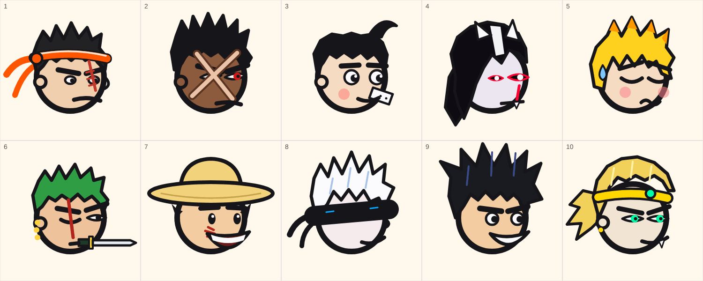

### Floor 1: Brass Shin, the Wrecking Kick
A headband with long tails, the scar, orange trunks with a white stripe, white shin tape and wraps. Signature: the Compressed Kick (a glowing shin, floor cracks, a guard it hits does not hold).

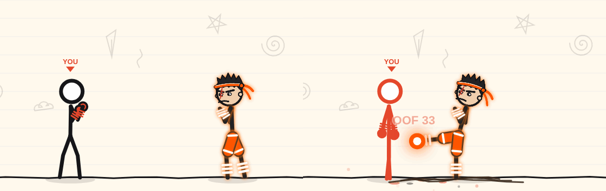
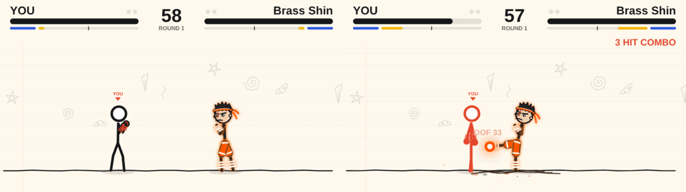

### Floor 2: Crosshatch, the Eraser Hand
The X scar over the eyes, one red eye, an open dark coat with red trim, a red sash and an arm covered in red tattoo lines. Signature: Matter Break, the blue crackle round the grabbing hand.

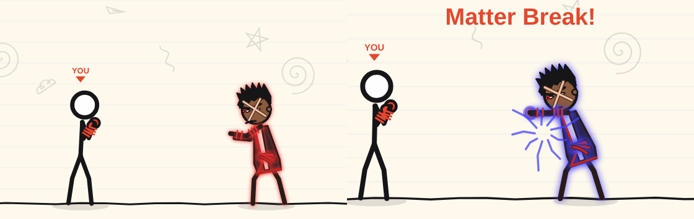
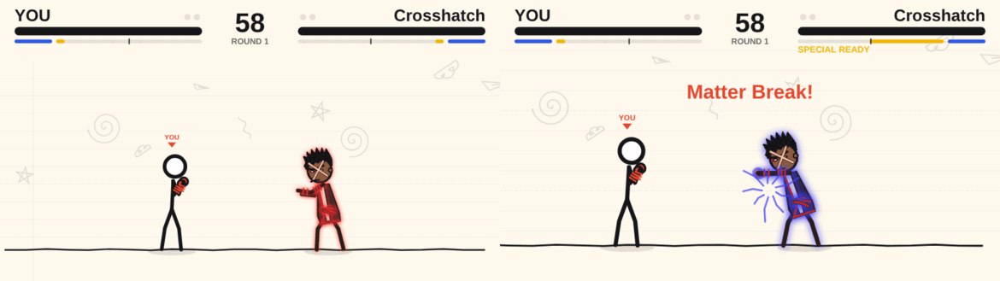

### Floor 3: Pip Punchline, the Rolling Fist
A pompadour with a curl, a plaster on the cheek, red gloves with white cuffs, blue trunks with a white stripe, always on the bob. Signature: the uppercut that ends his chain (the research's Dempsey Rising Uppercut).

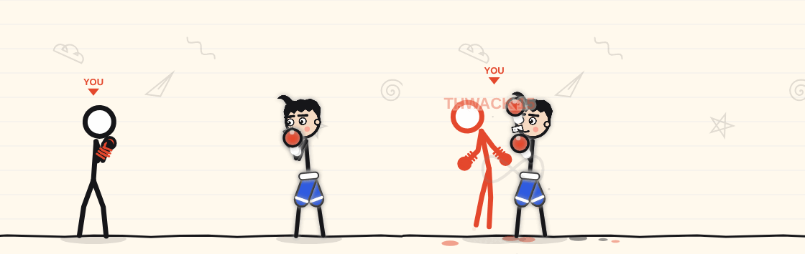
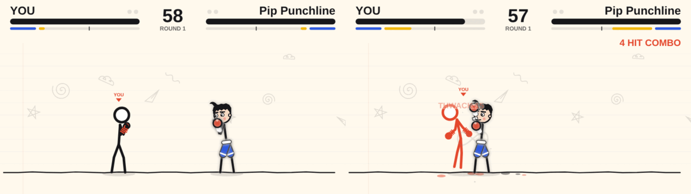

### Floor 4: Pale Ogre, the Counter Smash
Long black hair over one eye, small white horns, a pale face with red-rimmed eyes, a long black coat lined in red with a white trim. Signature: Pale Counter, the red arc of the stance.

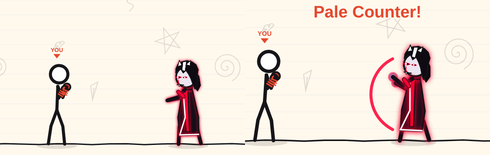
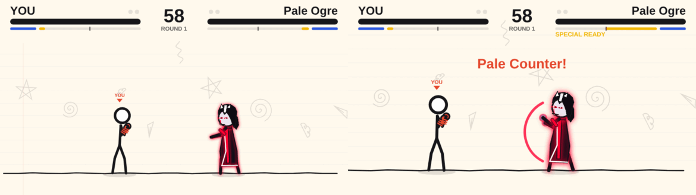

### Floor 5: Yellow Streak, the Sleeping Thunder
Yellow hair, closed eyes, a sweat drop, the yellow haori; the sword is sheathed (only the hilt shows) and he stands still. Signature: the draw, a lightning streak through you.

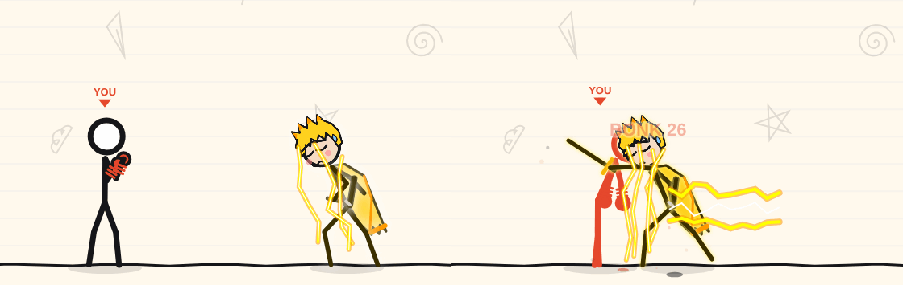
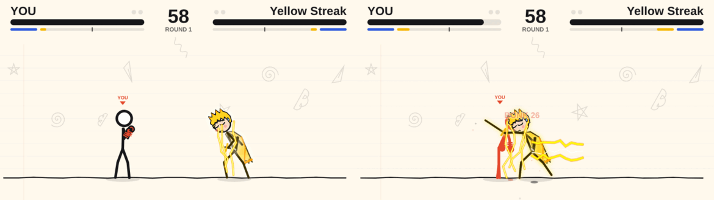

### Floor 6: Triple Nib, Lord of the Three Pens
Green hair, a scar down the eye, three gold earrings, a blade in the teeth, a sword in hand and two scabbards at a green sash. Signature: the Oni Cut, three green lines crossed over you.

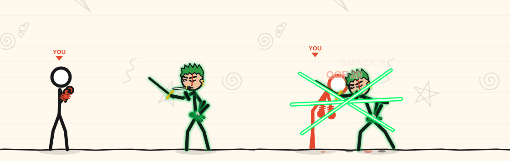
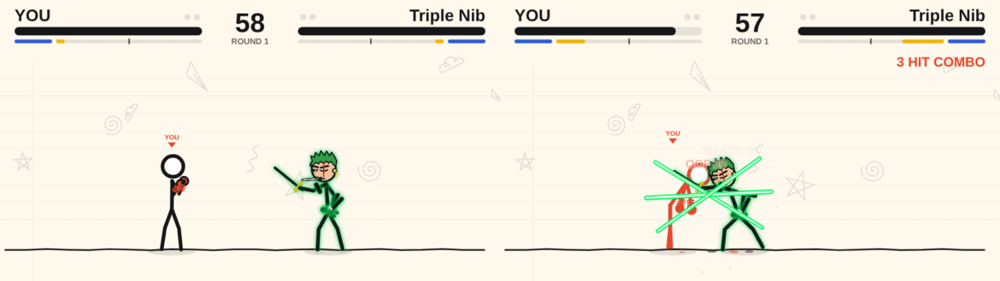

### Floor 7: Rubber Bo, the Elastic Storm
The straw hat, the stitched scar, the wide grin, a red vest. Signature: the rubber pistol, the arm drawn out to its 150 px reach.

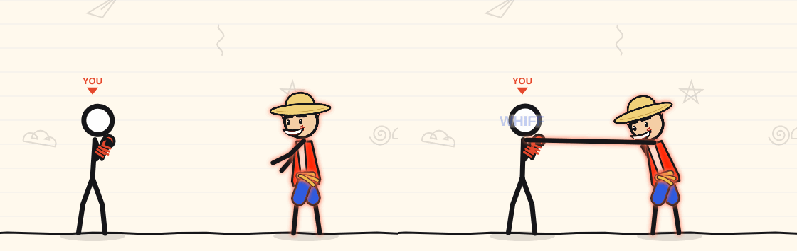
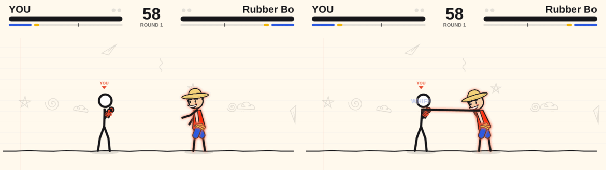

### Floor 8: Asymptote, the Limitless Margin
White hair, a blindfold, a long dark coat with a high collar, rings that ripple round him and three orbs (blue, red, violet) circling him. Signature: Void Grape, a purple beam in a blacked-out arena.

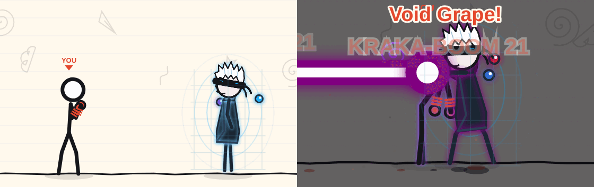
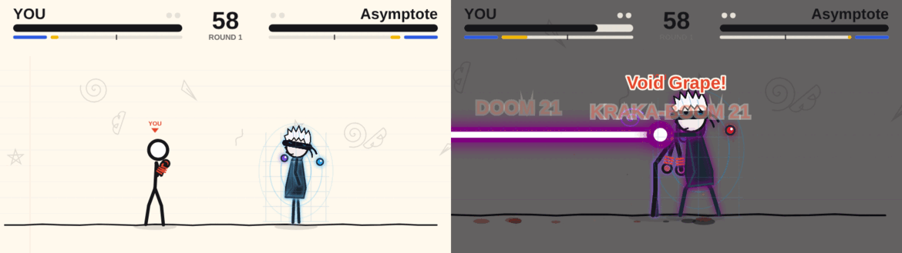

### Floor 9: Saffron Spike, the Wave Master
Black spikes, an orange and gold gi, blue wristbands, a gold ki glow that grows while he stands still. Signature: K-Wave, a cyan beam.

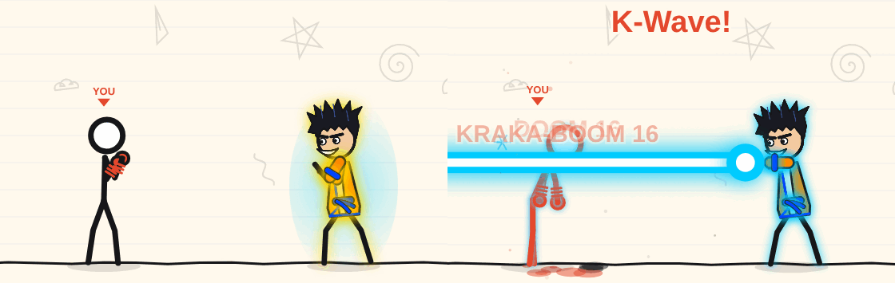
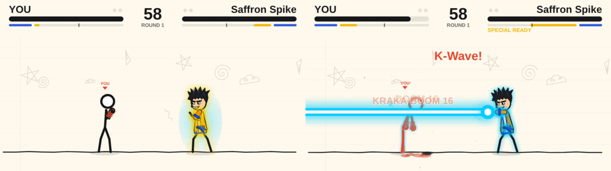

### Floor 10: The Overdue, King of Borrowed Time
Gold hair, the headband with its green gem, a violet and gold cape, a clock over his head whose hand follows his meter. Signature: Paused Ink World, the page inverts while the blows land.

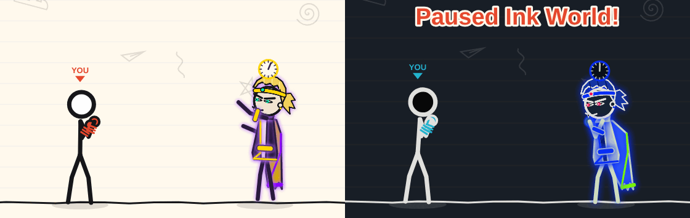
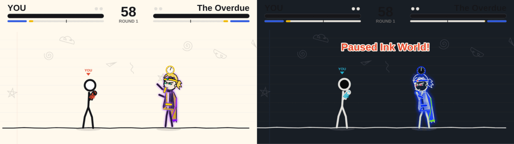

## 7. What I could not verify

- **Sound, by ear.** Nothing sounds different for a boss: its moves use the shared effect sounds, and no boss-only cue was added. I did not listen to a fight.
- **A human climb of the ladder.** Nobody played floors 1-10 by hand. The clear rates are the CPU stand-in's, and whether a telegraph reads in time (the Overdue's clock, the
  sheathed draw's glow, the stomp's floor cracks) was judged from still frames and from the AI's reaction numbers, not from a person's reaction.
- **Motion at 60 fps.** Frames are stills. The cloth sway, the aura loops, the rubber stretch timing and the time stop's inversion were seen one frame at a time (and in a real
  browser fight through screenshots), never as a film.
- **Real phones and touch.** The phone frames are a 390 px wide viewport in headless Chromium. The joystick, the ULT button and the layout of `/play/dungeon` on a real device were not
  tried against these bosses; a gamepad neither.
- **Online and the relay.** A boss is a computer opponent in the browser; no boss fight went through a room, WebRTC or the Supabase relay.
- **"Reduce flashes" at the time stop.** It is coded (a softer inversion, no impact frame on the echo blows) and was not seen.
- **Share cards and the boss PNG in production.** `/boss-art/N` was called as a route handler under tsx and its PNGs were looked at; it was not requested from a running
  deployment or through the card renderer's own fetch, because nothing is deployed from this branch.
- **Deploy.** Not deployed and not merged (by the rules). There is no migration and `vercel-build` is untouched, so nothing needs applying first.

## 8. Try it yourself

```
npm run dev                                   # http://localhost:3001; log in (demo1@inkfight.app / inkfight123), open /play/dungeon
                                              # floors open in order; an admin account has every floor
npx tsx scripts/dungeon.ts 200                # the clear curve, what every boss throws, looks, rewards, official names
SEED0=777 npx tsx scripts/dungeon.ts 200      # the same curve on fresh seeds
npx tsx scripts/dungeon.ts --tune 200         # re-fit the budgets (copy the printed BUDGETS into src/game/dungeon.ts)
npx tsx scripts/check-sim.ts                  # the sim, the normal-fight hashes, the bosses
npx tsx scripts/balance.ts 200                # normal PvP: must print what main prints
node scripts/shots-8/run.mjs out specs.json 960 540 1    # frames; 390 300 3 for the phone, `heads` instead of specs.json for the sheet
                                                         # (needs Playwright: PLAYWRIGHT_DIR, default /opt/node-tools)
```

A spec is `{ "name": "b6-sig", "floor": 6, "at": "move", "move": "oniCut", "t": 11 }` (`at`: idle, move, special, ult, walk, hit, form2, armed; see `scripts/shots-8/entry.ts`).

### By hand (the reviewer's list)

Open `/play/dungeon`, play each floor as the keys allow (A / D move, W jump, S block, J punch, K kick, L special, S + L ultimate, U side skill; the pad and the touch buttons do the same).
The cards on the ladder show each boss's tier, passive and hint; check the card text against what happens.

| Floor | What to see |
|---|---|
| 1 Brass Shin | He walks you down and kicks. Block the knee and the roundhouse; step back from the shin cannon (orange glow, floor cracks); a block against it breaks ("GUARD CRUSH") and you cannot guard for about 0.7 s. |
| 2 Crosshatch | Blocking works until he grabs (Matter Break): jump or step it. Three clean hits and the next one bleeds you (the cracks on his arm count the stacks). |
| 3 Pip Punchline | Punches only, never a kick. Swing at a bobbing target and he slips it (once per 6 s); hit him when he stops. The long barrage is Infinity Hooks. |
| 4 Pale Ogre | He holds back behind his guard. Mash into it and the third blocked hit throws you; swing and he answers with the counter. Bait the counter, punish the whiff. |
| 5 Yellow Streak | Stands absolutely still, sword sheathed (the hilt only). When you walk in he draws: a lightning dash. Block or jump it and punish the recovery. He throws nothing else. |
| 6 Triple Nib | No step back. The wind-up of his swings is not interrupted (armour); block it and punish the recovery. When you turtle the teleport cut comes from behind. |
| 7 Rubber Bo | His arm stretches out to 150 px, further than any of yours. Punches barely hurt him (a wobble and a BOING); kick him. Spacing wins. |
| 8 Asymptote | Projectiles barely hurt him; rings ripple out of him and a ruled grid shimmers round his body. Crowd him for 1.5 s and the ink-blot shimmer ends in a blink across the page; hit him in the shimmer to cancel it. |
| 9 Saffron Spike | He stands and charges (the glow grows). Close in on him while he charges; jump the cyan beam. |
| 10 The Overdue | The clock above his head follows his meter and flashes when full; inside 180 px the stop takes you (the page inverts, eight blows, a launch). At half health the page tints gold and violet ("TIME UNWINDS") and the knives come four at a time. |

Then open `/build` after clearing a floor and check that the floor's reward is in the special picker (even floors: the kind; odd floors: the named, element-tinted variant), and that
nothing is listed before its floor.
